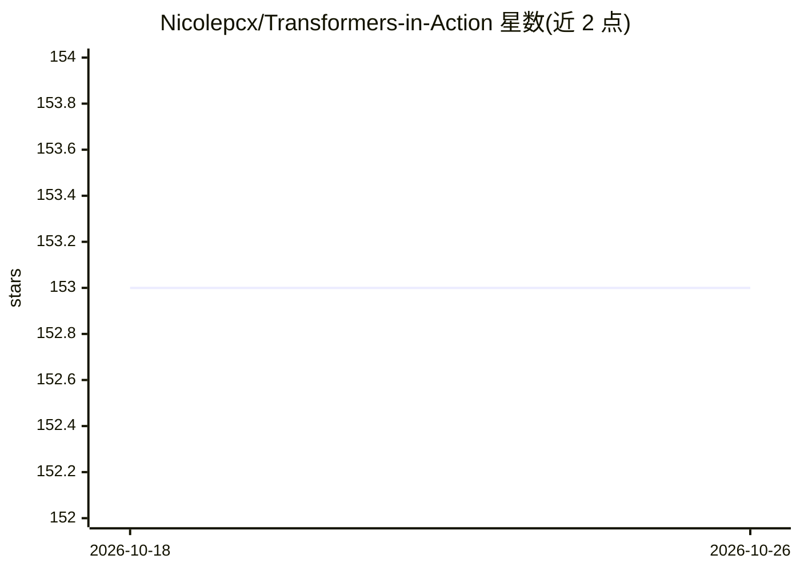

# Nicolepcx/Transformers-in-Action

⭐ 153 · Jupyter Notebook · NOASSERTION · 推送 2025-10-31 · [GitHub](https://github.com/Nicolepcx/Transformers-in-Action) · 个人维护

**《Transformers in Action》图书配套代码：各章 NLP/LLM Jupyter 笔记本**

书籍 Transformers in Action 的配套代码仓库，按章节（CH 前缀文件夹）组织 Jupyter 笔记本，覆盖 Transformer 基础、文本摘要、机器翻译、文本分类、文本生成、提示与少样本学习、多模态模型、大模型优化与评估及伦理议题。笔记本书设计为在带 GPU 的云服务（Colab、Gradient）上运行，每本笔记自动克隆仓库并按章安装依赖；同时提供 create_env.sh 脚本用 conda 或 pipenv 创建本地虚拟环境。运行需 GPU。

## 筛选速览

| 维度 | 判定 | 备注 |
|---|---|---|
| AI 角色 | `ai-knowledge` | 知识聚合/清单类 |
| 许可风险 | `none` | NOASSERTION |
| 部署形态 | `None` |  |
| 模型依赖 | — | README 未给出锁定关系 |
| 硬件要求 | — | 无带数字的原话,不猜 |
| 安装摩擦 | `low` | 无编译、无系统依赖或容器化 |
| 成熟度 | — | 结构信号不足 |

## 能力要点

- 按章节组织的 Jupyter 笔记本，覆盖摘要/翻译/分类/生成等 NLP 任务
- 每本笔记本含 Colab 与 Gradient 云服务打开按钮，自动克隆仓库安装依赖
- create_env.sh 支持 conda/pipenv 在 Windows(WSL)/macOS/Linux 创建虚拟环境

## 适用场景

- 跟随图书章节动手实践 Transformer 与 NLP 任务
- 在 Colab/Gradient 等 GPU 云环境直接运行各章笔记本
- 参考文本生成、提示学习与大模型评估的实现代码

## 场景标签

`教程课程` · 领域:学习与行业

## 证据(README 行号)

> L5: This is the corresponding code for the book Transformers in Action
> L24: All of the code is organized into folders. Each folder starts with `CH` followed by the chapter number. For example

## 星数曲线

2026-10-18 153 → 2026-10-26 153（+0）

---
*卡片 v1 · prompt 1.4 · 生成 2026-10-22 · 置信度 high · 依据 README sha `f9155ed79617` · [字段定义](../../DATASET.md)*
