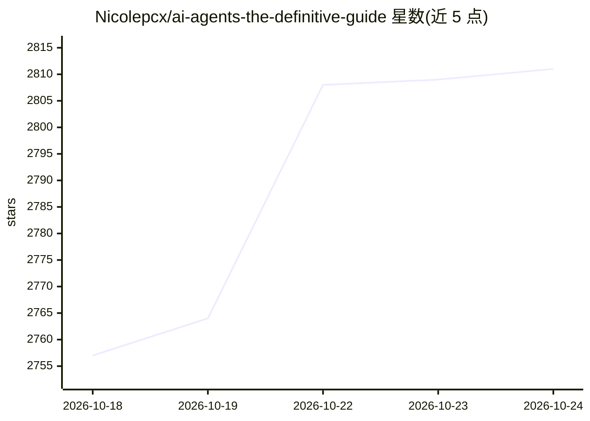

# Nicolepcx/ai-agents-the-definitive-guide

⭐ 2,813 · Jupyter Notebook · 推送 2026-08-01 · [GitHub](https://github.com/Nicolepcx/ai-agents-the-definitive-guide) · [官网](https://www.oreilly.com/library/view/ai-agents-the/0642572247775/) · 个人维护

**《AI Agents - The Definitive Guide》配套代码：12 章 agent 学习 notebook**

一本 O'Reilly 图书《AI Agents - The Definitive Guide》的配套代码仓库，按 12 章组织 Jupyter notebook，覆盖从 LLM 到 agent 的基础、规划与多智能体架构、生产化与工具治理、评测与观测、记忆机制、成本优化与威胁建模等主题。每个 notebook 提供 Open In Colab 徽章，可在 Google Colab 直接打开运行；代码按 CH 编号文件夹组织，notebook 文件名标注章号与内容主题。图书另有配套网站、测验与 Discord 频道，并在 Amazon 销售。

## 筛选速览

| 维度 | 判定 | 备注 |
|---|---|---|
| AI 角色 | `ai-knowledge` | 知识聚合/清单类 |
| 许可风险 | `none` | — |
| 部署形态 | `None` |  |
| 模型依赖 | — | README 未给出锁定关系 |
| 硬件要求 | — | 无带数字的原话,不猜 |
| 安装摩擦 | `low` | 无编译、无系统依赖或容器化 |
| 成熟度 | — | 结构信号不足 |

## 能力要点

- 12 章 Jupyter notebook 配套图书章节
- 每个 notebook 可通过 Open In Colab 徽章在 Google Colab 直接运行
- 主题覆盖多智能体系统、评测、记忆、安全与部署

## 适用场景

- 跟随图书系统学习 AI agent 架构与生产化实践
- 在 Colab 中直接运行书中示例（CoT、ReAct、MCP、LangGraph 等）
- 查阅 agent 评测与威胁建模的参考实现

## 场景标签

`教程课程` · 领域:学习与行业

## 证据(README 行号)

> L7: This is the corresponding code for the book AI Agents - The Definitive Guide
> L25: All of the code is organized into folders. Each folder starts with `CH` followed by the chapter number. For example
> L40: Every notebook can be opened and run on Google Colab directly from the links below. Just click the **Open In Colab*

## 星数曲线

2026-10-18 2,757 → 2026-10-24 2,811（+54）

---
*卡片 v1 · prompt 1.4 · 生成 2026-10-21 · 置信度 high · 依据 README sha `434d4e3a8b11` · [字段定义](../../DATASET.md)*
