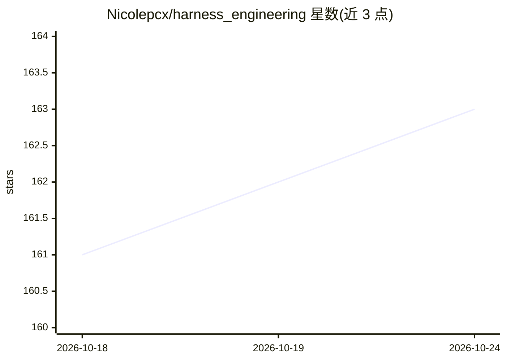

# Nicolepcx/harness_engineering

⭐ 163 · Jupyter Notebook · 推送 2026-08-18 · [GitHub](https://github.com/Nicolepcx/harness_engineering) · 个人维护

**O'Reilly《Harness Engineering》一书配套代码笔记本集**

O'Reilly 书籍 Harness Engineering: Optimization, Coordination, and Adaptive Agentic Systems 的配套代码仓库。按 12 个章节组织为 CH 前缀文件夹，每章含 Jupyter 笔记本，覆盖技能编译、Agent 身份边界、工具沙箱、多 Agent 协调、可观测性与治理等主题。笔记本可从 README 中的链接直接在 Google Colab 打开运行，部分笔记本可能需要 GPU。给读者与开发者提供随书动手实践材料。

## 筛选速览

| 维度 | 判定 | 备注 |
|---|---|---|
| AI 角色 | `ai-knowledge` | 知识聚合/清单类 |
| 许可风险 | `none` | — |
| 部署形态 | `None` |  |
| 模型依赖 | — | README 未给出锁定关系 |
| 硬件要求 | — | 无带数字的原话,不猜 |
| 安装摩擦 | `low` | 无编译、无系统依赖或容器化 |
| 成熟度 | — | 结构信号不足 |

## 能力要点

- 12 章随书 Jupyter 笔记本，按 CH 文件夹组织
- 每章笔记本可直接通过 Open In Colab 链接运行
- 主题覆盖技能编译、协调层、治理与 Harness 优化

## 适用场景

- 跟随书籍逐章动手实践 Harness Engineering 内容
- 在 Colab 上无需本地环境运行书中示例
- 查阅多 Agent 协调与治理的参考实现

## 场景标签

`多智能体` `教程课程` · 领域:Agent 开发

## 证据(README 行号)

> L7: This is the corresponding code for the book Harness Engineering: Optimization, Coordination, and Adaptive Agentic Sy
> L24: All of the code is organized into folders. Each folder starts with `CH` followed by the chapter number. For example

## 星数曲线

2026-10-18 161 → 2026-10-24 163（+2）

---
*卡片 v1 · prompt 1.4 · 生成 2026-10-22 · 置信度 high · 依据 README sha `6c67608706a1` · [字段定义](../../DATASET.md)*
