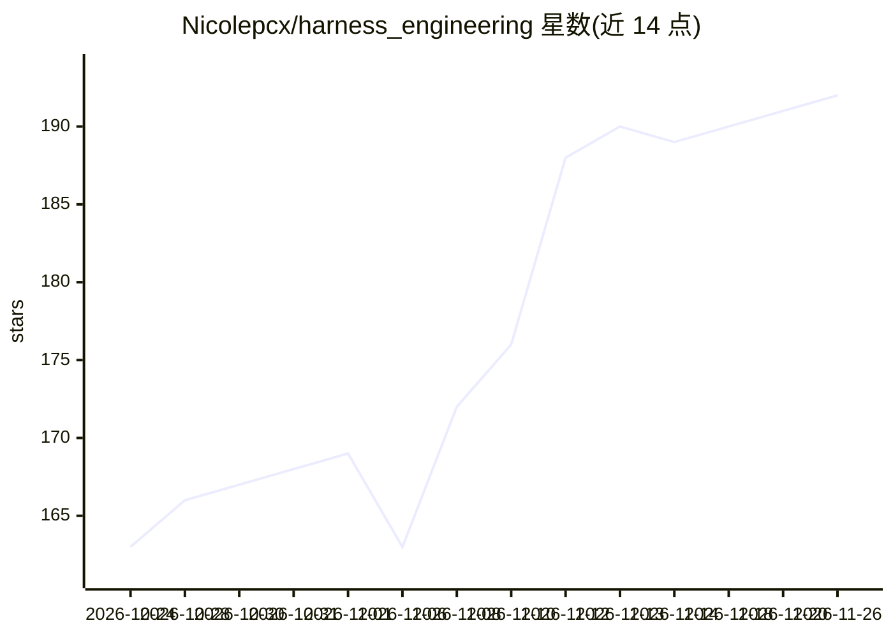

# Nicolepcx/harness_engineering

⭐ 192 · Jupyter Notebook · 推送 2026-11-10 · [GitHub](https://github.com/Nicolepcx/harness_engineering) · 个人维护

**O'Reilly《Harness Engineering》一书的配套代码与笔记本**

O'Reilly 书籍《Harness Engineering: Optimization, Coordination, and Adaptive Agentic Systems》的配套代码仓库，按 12 章组织 Jupyter 笔记本，主题覆盖 agent 系统底座、技能与信任边界、多智能体协调、可观测性与遥测、治理等。每个笔记本提供 Google Colab 徽章可直接在线运行，仓库注明部分笔记本可能需要 GPU。内容面向阅读该书并动手实践的开发者。

## 筛选速览

| 维度 | 判定 | 备注 |
|---|---|---|
| AI 角色 | `ai-knowledge` | 知识聚合/清单类 |
| 许可风险 | `none` | — |
| 部署形态 | `None` |  |
| 模型依赖 | — | README 未给出锁定关系 |
| 硬件要求 | — | 无带数字的原话,不猜 |
| 安装摩擦 | `low` | 无编译、无系统依赖或容器化 |
| 成熟度 | — | 结构信号不足 |

## 能力要点

- 12 章配套 Jupyter 笔记本，按 CHxx 文件夹组织
- 每个笔记本提供 Open In Colab 徽章在线运行
- 章节主题覆盖技能、信任边界、协调、可观测性与治理

## 适用场景

- 边读《Harness Engineering》边运行书中代码示例
- 学习 agent harness 的技能注册与状态管理模式
- 参考书中的评测与遥测实践（如 Langfuse 笔记本）

## 场景标签

`教程课程` · 领域:学习与行业

## 证据(README 行号)

> L7: This is the corresponding code for the book Harness Engineering: Optimization, Coordination, and Adaptive Agentic Sy
> L39: Every notebook can be opened and run on Google Colab directly from the links below. Just click the **Open In Colab*

## 星数曲线

2026-10-24 163 → 2026-11-26 192（+29）

---
*卡片 v1 · prompt 1.4 · 生成 2026-11-26 · 置信度 high · 依据 README sha `746a91f7e7a1` · [字段定义](../../DATASET.md)*
