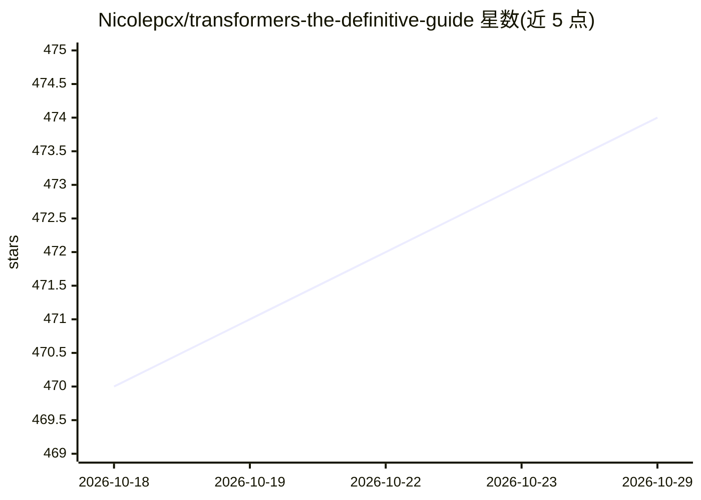

# Nicolepcx/transformers-the-definitive-guide

⭐ 474 · Jupyter Notebook · Apache-2.0 · 推送 2026-08-05 · [GitHub](https://github.com/Nicolepcx/transformers-the-definitive-guide) · 个人维护

**《Transformers: The Definitive Guide》一书配套代码仓库**

O'Reilly 图书 Transformers - The Definitive Guide 的官方配套代码库：按 12 章组织 Jupyter notebook，覆盖 Transformer 基础原理、时间序列、视觉、图像/视频生成、音频任务、强化学习、规划推理、AI Agent、优化与部署。每个 notebook 提供 Open In Colab 链接，运行时自动克隆本仓库并安装各章依赖；本地可用 create_env.sh 脚本创建 conda/pipenv 虚拟环境。notebook 设计在带 GPU 的云端服务上运行，需 GPU。

## 筛选速览

| 维度 | 判定 | 备注 |
|---|---|---|
| AI 角色 | `ai-knowledge` | 知识聚合/清单类 |
| 许可风险 | `permissive` | Apache-2.0 |
| 部署形态 | `None` |  |
| 模型依赖 | — | README 未给出锁定关系 |
| 硬件要求 | — | 无带数字的原话,不猜 |
| 安装摩擦 | `low` | 无编译、无系统依赖或容器化 |
| 成熟度 | — | 结构信号不足 |

## 能力要点

- 12 章 Jupyter notebook 覆盖时间序列/视觉/音频/强化学习/Agent/部署等主题
- 每个 notebook 带 Open In Colab 徽章，可直接云端运行
- 运行 notebook 自动克隆仓库并按章安装依赖
- 提供 create_env.sh 创建 conda/pipenv 虚拟环境

## 适用场景

- 跟随图书逐章实践 Transformer 各领域代码
- 在 Colab 上直接运行示例而无需本地配置
- 查找特定任务（时间序列、音频、视频生成等）的参考实现 notebook

## 场景标签

`教程课程` · 领域:学习与行业

## 证据(README 行号)

> L7: This is the corresponding code for the book Transformers - The definitive Guide
> L10: ## TOC

## 星数曲线

2026-10-18 470 → 2026-10-29 474（+4）

---
*卡片 v1 · prompt 1.4 · 生成 2026-10-21 · 置信度 high · 依据 README sha `e8d07c4c573c` · [字段定义](../../DATASET.md)*
