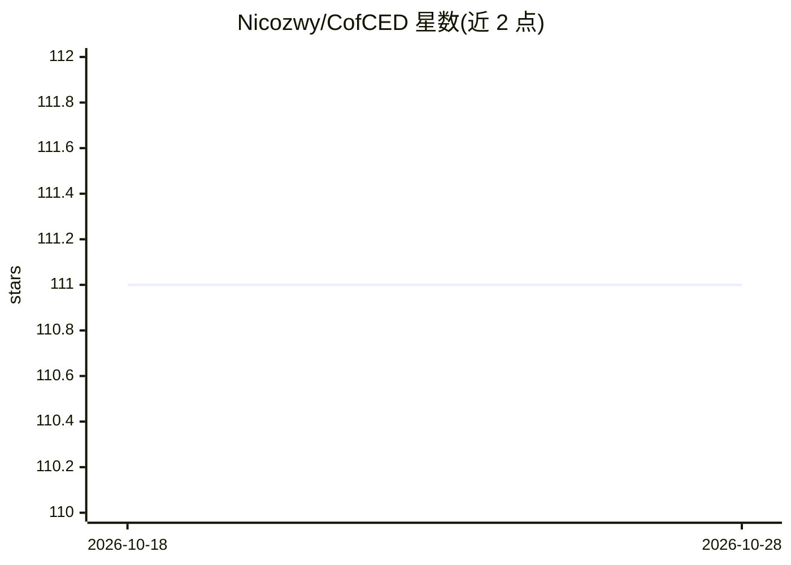

# Nicozwy/CofCED

⭐ 111 · Python · Apache-2.0 · 推送 2026-02-03 · [GitHub](https://github.com/Nicozwy/CofCED) · [官网](https://aclanthology.org/2022.coling-1.230/) · 个人维护

**COLING 2022 论文代码：可解释虚假新闻检测模型与数据集**

论文《A Coarse-to-fine Cascaded Evidence-Distillation Neural Network for Explainable Fake News Detection》（COLING 2022）的官方代码仓库，提出 CofCED 方法，直接利用群体智慧（原始报道）做可解释的虚假新闻检测，降低对事实核查报道的依赖。仓库同时发布两个自建数据集 RAWFC 与 LIAR-RAW，每个 claim 附带原始报道。以 Python 3.8 + PyTorch 环境安装运行，面向科研复现者。

## 筛选速览

| 维度 | 判定 | 备注 |
|---|---|---|
| AI 角色 | `ai-native` | 本体是模型或模型工具 |
| 许可风险 | `permissive` | Apache-2.0 |
| 部署形态 | `library` | 以包/库形式分发 |
| 模型依赖 | — | README 未给出锁定关系 |
| 硬件要求 | — | 无带数字的原话,不猜 |
| 安装摩擦 | `low` | 无编译、无系统依赖或容器化 |
| 成熟度 | — | 结构信号不足 |

## 能力要点

- 粗到细级联证据蒸馏网络（CofCED），输出可解释的虚假新闻检测结果
- 直接利用原始报道（wisdom of crowds），降低对 fact-checked 报道的依赖
- 发布 RAWFC 与 LIAR-RAW 两个数据集

## 适用场景

- 复现 COLING 2022 论文的虚假新闻检测实验
- 在 RAWFC/LIAR-RAW 数据集上开展可解释检测研究
- 对比基于原始报道的证据抽取方法

## 场景标签

`科研工具` · 领域:学习与行业

## 证据(README 行号)

> L6: `A Coarse-to-fine Cascaded Evidence-Distillation Neural Network for Explainable Fake News Detection` is accepted by 
> L7: `CofCED` is an explainable method proposed by this paper. We present the first study on explainable fake news detect

## 星数曲线

2026-10-18 111 → 2026-10-28 111（+0）

---
*卡片 v1 · prompt 1.4 · 生成 2026-10-23 · 置信度 high · 依据 README sha `a64e7abc09d8` · [字段定义](../../DATASET.md)*
