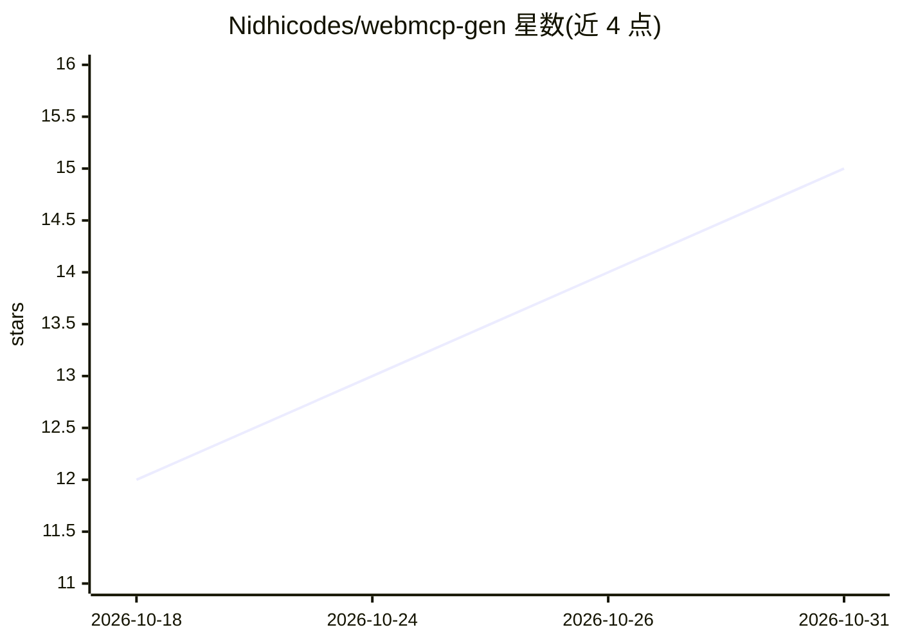

# Nidhicodes/webmcp-gen

⭐ 15 · Python · MIT · 推送 2026-06-02 · [GitHub](https://github.com/Nidhicodes/webmcp-gen) · 个人维护

**从任意网站自动生成可调用 MCP 工具的生成器**

面向 AI agent 开发者的 Python 工具：用 Playwright 驱动真实浏览器读取网页，把页面上的表单、按钮、导航转换为带名称、类型与 CSS 选择器绑定的 MCP 工具定义，并可实际执行调用、返回结构化结果。无需网站配合或 API。LLM 模式兼容 OpenAI 接口（Groq/OpenAI/本地 Ollama），另有工作流链式执行、站点爬取合并工具、登录会话复用、反检测补丁与内置基准测试。以官方 MCP SDK 实现 stdio/SSE/streamable-HTTP 传输，可作为库导入，需 Python 3.10+ 与 Chromium。

## 筛选速览

| 维度 | 判定 | 备注 |
|---|---|---|
| AI 角色 | `ai-ecosystem` | LLM/agent 周边工具 |
| 许可风险 | `permissive` | MIT |
| 部署形态 | `library` | 以包/库形式分发 |
| 模型依赖 | local-ok | 支持本地模型 |
| 硬件要求 | — | 无带数字的原话,不猜 |
| 安装摩擦 | `low` | 无编译、无系统依赖或容器化 |
| 成熟度 | — | 结构信号不足 |

## 能力要点

- 网页 UI 元素自动转换为带 CSS 选择器绑定的 MCP 工具定义
- 基于官方 MCP SDK 的服务器，支持 stdio/SSE/streamable-HTTP
- 工作流链式执行与 `--crawl` 站点爬取合并工具
- CAPTCHA/拦截页返回 blocked 而非伪造成功

## 适用场景

- 让 Claude Desktop 等 MCP 客户端直接调用未开放 API 的网站功能
- 把搜索框等页面元素变成 agent 可调用的类型化工具
- 多步任务（搜索→打开→操作）写成工作流链式执行
- 对需登录的站点复用会话执行工具

## 场景标签

`浏览器自动化` `Agent 框架` · 领域:Agent 开发

## 证据(README 行号)

> L120: webmcp-gen runs as a real MCP server using the
> L42: webmcp-gen is option 2. It treats the website's own UI — its forms, its buttons,

## 星数曲线

2026-10-18 12 → 2026-10-31 15（+3）

---
*卡片 v1 · prompt 1.4 · 生成 2026-10-31 · 置信度 high · 依据 README sha `478a06553c61` · [字段定义](../../DATASET.md)*
