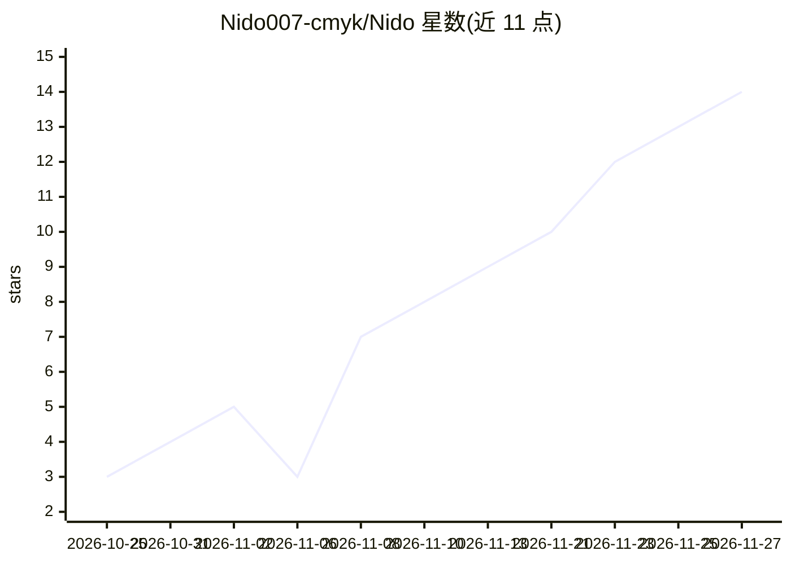

# Nido007-cmyk/Nido

⭐ 14 · TypeScript · MIT · 推送 2026-11-26 · [GitHub](https://github.com/Nido007-cmyk/Nido) · [官网](https://github.com/Nido007-cmyk/Nido/releases) · 个人维护

**100% 离线运行的 Android 隐私优先个人 AI 助手**

面向 Android 手机的本地个人助手：通过 llama.cpp（llama.rn）在设备上运行 0.4–5 GB 的端侧语言模型（Qwen、Phi、Gemma、LFM），聊天、记忆、文档索引与检索全部留在设备端并加密（SQLCipher + Android Keystore）。支持提醒/倒计时/日历等操作型请求（带确认机制）、多语言文档导入与 OCR、内置知识库及签名验证的知识包导入，并支持蓝牙与 Wi-Fi 的端到端加密 P2P。当前为早期 alpha，未经独立安全审计，无云、无账号、无分析。

## 筛选速览

| 维度 | 判定 | 备注 |
|---|---|---|
| AI 角色 | `ai-native` | 本体是模型或模型工具 |
| 许可风险 | `permissive` | MIT |
| 部署形态 | `library` | 以包/库形式分发 |
| 模型依赖 | — | README 未给出锁定关系 |
| 硬件要求 | — | 无带数字的原话,不猜 |
| 安装摩擦 | `low` | 无编译、无系统依赖或容器化 |
| 成熟度 | `idea` | |

## 能力要点

- 端侧运行 llama.cpp 模型（0.4–5 GB），无云无账号
- SQLCipher 加密记忆 + Android Keystore 管理密钥
- 知识包 Ed25519 签名验证导入，答案标注来源与模型贡献占比
- grounding judge 语义比对与低内存设备的模型加载调度

## 适用场景

- 无网络或不愿使用云服务的场景下进行本地 AI 对话
- 导入个人文档并在手机上离线检索问答
- 管理提醒、倒计时与日历等日常事务
- 离线查询应急指南与 69 国急救电话

## 场景标签

`AI 助手` `文档问答` `OCR` · 领域:对话与助手

## 证据(README 行号)

> L8: A private AI assistant that runs entirely on your Android phone.
> L31: - **Chats offline** with a small language model that runs on the phone
> L32:  (llama.cpp through `llama.rn`).

## 星数曲线

2026-10-25 3 → 2026-11-27 14（+11）

---
*卡片 v1 · prompt 1.4 · 生成 2026-11-20 · 置信度 mid · 依据 README sha `af3fd9fb523d` · [字段定义](../../DATASET.md)*
