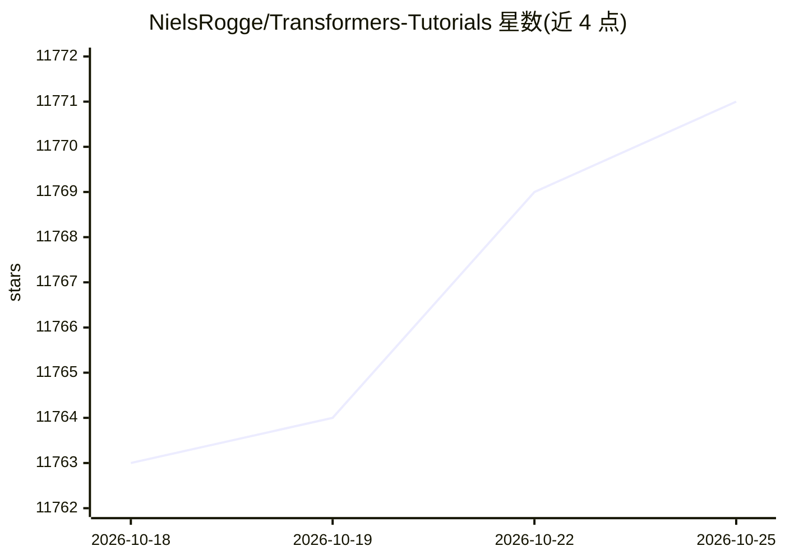

# NielsRogge/Transformers-Tutorials

⭐ 11,771 · Jupyter Notebook · MIT · 推送 2026-09-17 · [GitHub](https://github.com/NielsRogge/Transformers-Tutorials) · 个人维护

**HuggingFace Transformers 各类模型微调与推理示例笔记本合集**

作者基于 Transformers 库制作的 Jupyter/Colab 演示合集，全部以 PyTorch 实现，覆盖 40 余种 Transformer 架构（BERT、GPT-2、DETR、LayoutLM 系列、SAM、TrOCR、ViT 等），每条演示对应一篇论文并可一键在 Google Colab 打开。内容以两类操作为主：在标准数据集上微调模型，以及执行推理并配合 Gradio 做演示；另附 PyTorch Dataset/DataLoader 数据预处理说明。作者自述为向库中添加其中多个算法的主要贡献者。

## 筛选速览

| 维度 | 判定 | 备注 |
|---|---|---|
| AI 角色 | `ai-knowledge` | 知识聚合/清单类 |
| 许可风险 | `permissive` | MIT |
| 部署形态 | `library` | 以包/库形式分发 |
| 模型依赖 | — | README 未给出锁定关系 |
| 硬件要求 | — | 无带数字的原话,不猜 |
| 安装摩擦 | `low` | 无编译、无系统依赖或容器化 |
| 成熟度 | — | 结构信号不足 |

## 能力要点

- 覆盖 40 余种 Transformer 架构的微调与推理笔记本
- 每条演示对应论文链接并可直接在 Colab 打开
- 全部演示以 PyTorch 实现，部分用 Trainer/PyTorch Lightning/Accelerate
- 附自定义 Dataset 与 DataLoader 的数据预处理示例

## 适用场景

- 学习某类 Transformer 模型如何微调或推理
- 为自己的数据集做图像分类、目标检测或文档理解时找参考代码
- 通过 Colab 免本地环境快速跑通演示

## 场景标签

`微调` `教程课程` · 领域:学习与行业

## 证据(README 行号)

> L5: This repository contains demos I made with the Transformers library by 🤗 HuggingFace. Currently, all of them are imp
> L11: Currently, it contains the following demos:
> L13:  - performing inference with `ASTForAudioClassification` to classify audio. Open In Colab

## 星数曲线

2026-10-18 11,763 → 2026-10-25 11,771（+8）

---
*卡片 v1 · prompt 1.4 · 生成 2026-10-20 · 置信度 mid · 依据 README sha `ed47a4f4ec04` · [字段定义](../../DATASET.md)*
