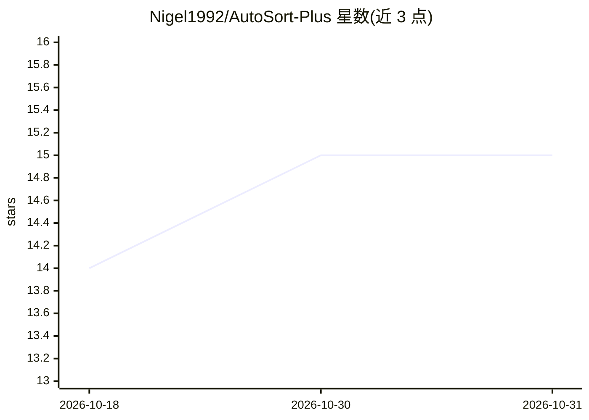

# Nigel1992/AutoSort-Plus

⭐ 15 · JavaScript · MIT · 推送 2026-10-29 · [GitHub](https://github.com/Nigel1992/AutoSort-Plus) · [官网](https://nigel1992.github.io/AutoSort-Plus/) · 个人维护

**AI 自动邮件分类的 Thunderbird 扩展**

Thunderbird 邮件客户端扩展：用户右键选择多封邮件后调用 AI 分析内容并移动到 IMAP 文件夹或自定义分类，也支持不经过 AI 的手动标签。提供 6 种 AI 提供方选择，含 Gemini 多 API key 轮换，以及本地 Ollama（llama3.2/tinyllama/phi/gemma，CPU-only 可用）。功能含批量处理进度面板、移动历史（100 条）、加密存储 key。限制：需手动触发，尚未上架 Thunderbird 商店，需手动安装 xpi。

## 筛选速览

| 维度 | 判定 | 备注 |
|---|---|---|
| AI 角色 | `ai-enhanced` | 去掉 AI 部分产品仍成立 |
| 许可风险 | `permissive` | MIT |
| 部署形态 | `None` |  |
| 模型依赖 | local-ok | 支持本地模型 |
| 硬件要求 | — | 无带数字的原话,不猜 |
| 安装摩擦 | `low` | 无编译、无系统依赖或容器化 |
| 成熟度 | `idea` | |

## 能力要点

- 6 种 AI 提供方（Gemini/OpenAI/Claude/Groq/Mistral/Ollama 本地）
- Gemini 多 API key 批量导入、自动轮换与配额管理
- 批量并行分析（1–20 可配）带进度面板、取消与失败重试
- API key 加密存储，邮件内容仅内存分析不落盘

## 适用场景

- 按自定义文件夹/分类批量整理收件箱邮件
- 在本地 Ollama 模型上离线分类邮件，不使用云 API
- 多 Gemini key 轮换以绕开每日免费配额限制

## 场景标签

 · 领域:邮件管理/桌面扩展

## 证据(README 行号)

> L7: ### AI-Powered Email Organization for Thunderbird
> L105: - Select emails → Right-click → **AutoSort+ → Batch Analyze with AI**

## 星数曲线

2026-10-18 14 → 2026-10-31 15（+1）

---
*卡片 v1 · prompt 1.4 · 生成 2026-10-30 · 置信度 high · 依据 README sha `9a70f3124a0f` · [字段定义](../../DATASET.md)*
