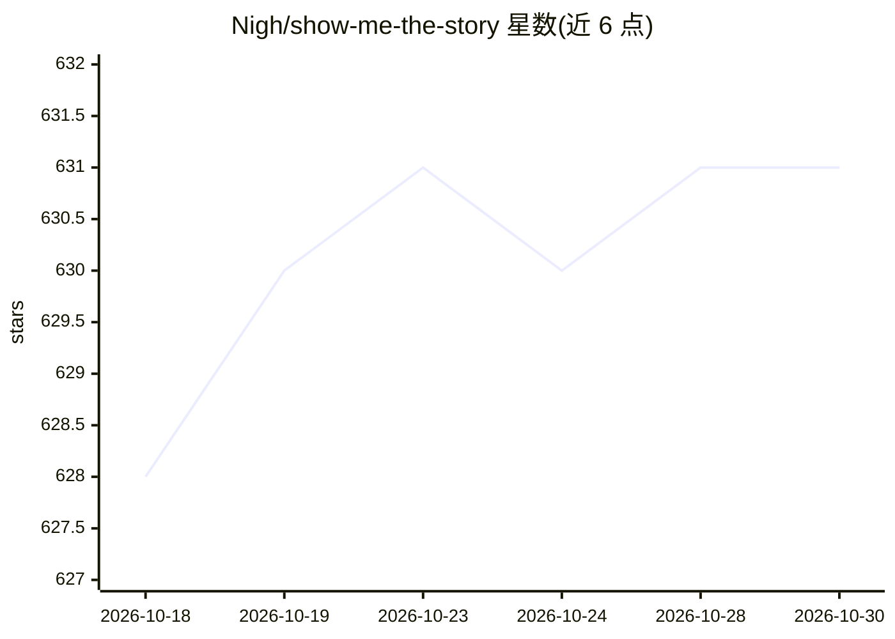

# Nigh/show-me-the-story

⭐ 631 · Go · MIT · 推送 2026-10-15 · [GitHub](https://github.com/Nigh/show-me-the-story) · 个人维护 · 中文 README

**自托管 AI 长篇小说写作工具：单可执行文件加 Web 界面**

Go 编写的本地小说写作应用：单个 5 MB 内可执行文件加浏览器界面，连接 OpenAI 兼容模型服务，管理多项目设定（角色、世界观、组织、关系图）、批量大纲规划（每批 1–36 章）、章节起草与修订、事实抽取与伏笔追踪、终稿校对与导出。默认端口 48090，数据本地存储于 storys/ 目录，支持 ZIP 备份恢复；AI 操作会将相关文本发送至所配置的模型服务。仅打开 v4 项目格式，面向中文与英文写作者。

## 筛选速览

| 维度 | 判定 | 备注 |
|---|---|---|
| AI 角色 | `ai-native` | 本体是模型或模型工具 |
| 许可风险 | `permissive` | MIT |
| 部署形态 | `desktop` | 安装包/桌面程序 |
| 模型依赖 | — | README 未给出锁定关系 |
| 硬件要求 | — | 无带数字的原话,不猜 |
| 安装摩擦 | `low` | 无编译、无系统依赖或容器化 |
| 成熟度 | — | 结构信号不足 |

## 能力要点

- 单可执行文件（<5 MB）加浏览器界面，自托管运行
- 批量大纲规划、章节起草、定向修订与可选自动确认
- 事实抽取（带来源引用）、设定变更提案与伏笔追踪
- 既有作品导入、续写项目、校对撤销与 text/outline/report 导出

## 适用场景

- 从梗概开始分批规划并撰写长篇小说
- 维护角色、世界观与伏笔的一致性并修订章节
- 导入已有作品续写或创建续作
- 本地保存与 ZIP 备份小说项目

## 场景标签

`AI 写作` · 领域:内容生成

## 证据(README 行号)

> L9: A local application for writing long fiction with AI. One executable and a browser interface connect to an OpenAI-co
> L11: **The complete application ships as a single executable under 5 MB**—small enough to download, move, and keep anywh

## 星数曲线

2026-10-18 628 → 2026-10-30 631（+3）

---
*卡片 v1 · prompt 1.4 · 生成 2026-10-22 · 置信度 mid · 依据 README sha `0ad01f01e9d4` · [字段定义](../../DATASET.md)*
