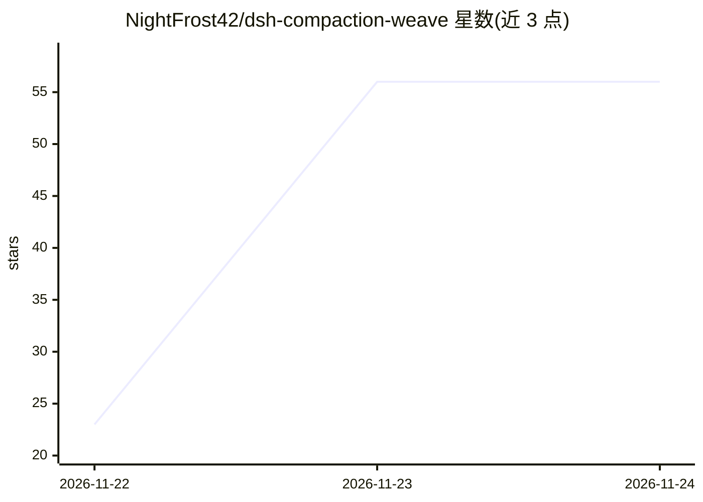

# NightFrost42/dsh-compaction-weave

⭐ 63 · JavaScript · MIT · 推送 2026-11-23 · [GitHub](https://github.com/NightFrost42/dsh-compaction-weave) · [官网](https://www.npmjs.com/package/dsh-compaction-weave)

**DeepSeek Harness 长对话上下文压缩插件：保留要求与进度**

为 DeepSeek Harness（DSH）宿主设计的上下文压缩插件，采用两级整理策略：先折叠超大工具输出并归档原文，不足时再调用摘要模型生成检查点，保留当前任务、有效要求、进度与下一步动作。提供 history_list/history_search/history_read 归档回查工具、通道隔离防止外部引用被误当用户指令、结构化进度校验、失败重试与指数退避。摘要模型默认跟随会话，可单独指定；发布于 npm 与 GitHub Releases，支持插件市场、CLI 与离线 tgz 安装，运行需 Node.js 24.9+ 与 DSH 0.2.2-rc.1+。

## 筛选速览

| 维度 | 判定 | 备注 |
|---|---|---|
| AI 角色 | `ai-ecosystem` | LLM/agent 周边工具 |
| 许可风险 | `permissive` | MIT |
| 部署形态 | `None` |  |
| 模型依赖 | — | README 未给出锁定关系 |
| 硬件要求 | — | 无带数字的原话,不猜 |
| 安装摩擦 | `low` | 无编译、无系统依赖或容器化 |
| 成熟度 | — | 结构信号不足 |

## 能力要点

- 两级整理：先折叠工具输出，必要时再总结，同路由保持请求前缀以命中服务商缓存
- 归档回查工具 history_list/search/read 支持按需检索被替换的原始消息
- 通道隔离区分真实用户指令与外部引用，独立核对数值、条件与 key: value 进度
- 支持桌面插件市场、dsh plugin CLI 与离线 tgz 三种安装方式

## 适用场景

- 长对话开发会话中压缩上下文同时保留任务要求与进度
- 需要回查早期报错、路径或代码细节时检索归档历史
- 跨多个模型切换的会话中保持压缩稳定性

## 场景标签

`Agent 记忆` · 领域:Agent 开发

## 证据(README 行号)

> L5: 面向 DeepSeek Harness 的上下文压缩插件，让长对话带着明确的目标、有效约束和下一步继续推进。
> L35: 支持 **DeepSeek Harness `>=0.2.2-rc.1 <1.0.0-0`**（`0.2.2-rc.1` 起的 `0.2.x–0.x` 系列），原生原子事务已实测 **DSH `0.2.2-rc.1`、`0.2.2

## 星数曲线

2026-11-22 23 → 2026-11-24 56（+33）

---
*卡片 v1 · prompt 1.4 · 生成 2026-11-22 · 置信度 mid · 依据 README sha `fa7479fecf67` · [字段定义](../../DATASET.md)*
