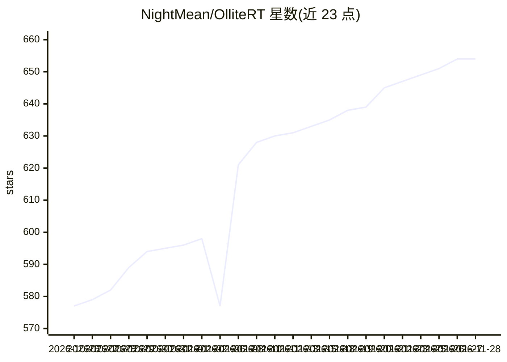

# NightMean/OlliteRT

⭐ 654 · Kotlin · Apache-2.0 · 推送 2026-11-26 · [GitHub](https://github.com/NightMean/OlliteRT) · 个人维护

**把 Android 手机变成 OpenAI 兼容的本地 LLM 推理服务器**

基于 Google LiteRT-LM 运行时的 Android 应用，在手机 GPU/CPU 上运行 LLM，并通过本地网络提供 OpenAI 与 Anthropic 兼容的 HTTP API。支持从 Hugging Face/ModelScope 下载模型或导入本地 .litertlm 文件，内置基准测试、请求日志、Prometheus 指标与 Home Assistant REST 控制接口。限制：仅 arm64-v8a、单模型单请求排队、不支持 GGUF、无 logprobs 与语法约束等运行时特性。面向需要在本地设备上运行推理服务的用户。

## 筛选速览

| 维度 | 判定 | 备注 |
|---|---|---|
| AI 角色 | `ai-ecosystem` | LLM/agent 周边工具 |
| 许可风险 | `permissive` | Apache-2.0 |
| 部署形态 | `None` |  |
| 模型依赖 | — | README 未给出锁定关系 |
| 硬件要求 | — | 无带数字的原话,不猜 |
| 安装摩擦 | `low` | 无编译、无系统依赖或容器化 |
| 成熟度 | — | 结构信号不足 |

## 能力要点

- 提供 OpenAI Chat/Completions/Responses 与 Anthropic Messages 兼容端点
- 通过 LiteRT-LM 在手机 GPU/CPU 上运行 .litertlm 模型
- 支持多模态（视觉/音频）、思考链与实验性工具调用
- 内置 Prometheus 指标、Grafana 对接与 Home Assistant 远程控制

## 适用场景

- 把闲置 Android 手机作为局域网内的本地 LLM 服务器
- 为 Home Assistant 提供本地语音与对话后端
- 在无外网/无 API key 环境下运行本地推理
- 在移动设备上对比测试不同模型的推理表现

## 场景标签

`推理引擎` · 领域:训练与推理

## 证据(README 行号)

> L9:  Turn your Android phone into an OpenAI-compatible API LLM server — fully local, private, and open source
> L23: **Think of it as Ollama for Android.** Pick a model, tap Start, and your phone becomes an LLM server — runs LLMs on
> L90: |`POST`|`/v1/chat/completions`|OpenAI Chat Completions API (streaming + non-streaming)|

## 星数曲线

2026-10-26 577 → 2026-11-28 654（+77）

---
*卡片 v1 · prompt 1.4 · 生成 2026-11-25 · 置信度 high · 依据 README sha `98cedc7f8fa5` · [字段定义](../../DATASET.md)*
