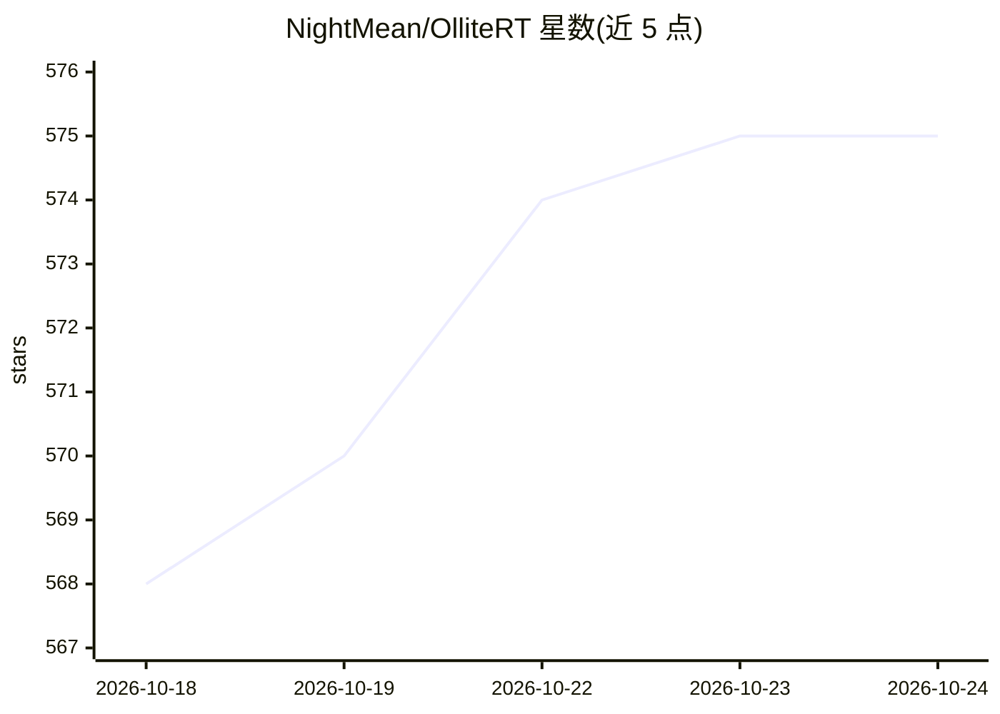

# NightMean/OlliteRT

⭐ 577 · Kotlin · Apache-2.0 · 推送 2026-10-24 · [GitHub](https://github.com/NightMean/OlliteRT) · 个人维护

**把 Android 手机变成 OpenAI 兼容的本地 LLM 推理服务器**

面向 Android 用户的本地 LLM 服务器应用：基于 Google LiteRT-LM 运行时在手机 GPU/CPU 上运行模型，通过 Ktor 提供 OpenAI 兼容 HTTP API（含 Anthropic Messages API、音频转录等端点）。支持从 HuggingFace 一键下载或导入 .litertlm 模型，提供内置基准测试、请求日志、Prometheus 指标与 Home Assistant REST API 集成。限制：仅 arm64-v8a、Android 12+、6GB 内存起步，单模型单请求，不支持 GGUF。APK 安装，开源 Apache 2.0。

## 筛选速览

| 维度 | 判定 | 备注 |
|---|---|---|
| AI 角色 | `ai-ecosystem` | LLM/agent 周边工具 |
| 许可风险 | `permissive` | Apache-2.0 |
| 部署形态 | `None` |  |
| 模型依赖 | — | README 未给出锁定关系 |
| 硬件要求 | — | 无带数字的原话,不猜 |
| 安装摩擦 | `low` | 无编译、无系统依赖或容器化 |
| 成熟度 | — | 结构信号不足 |

## 能力要点

- 在手机上运行 LLM 并以 OpenAI 兼容 HTTP API 对局域网提供服务
- 支持 OpenAI Chat/Completions/Responses 与 Anthropic Messages 端点
- 内置基准测试、活动日志与 Prometheus 指标监控
- 可从 HuggingFace 一键下载或本地导入 .litertlm 模型

## 适用场景

- 用闲置旧手机搭建常驻低功耗的本地 LLM 服务器
- 让 Open WebUI、Home Assistant 等 OpenAI 兼容客户端接入手机上的本地模型
- 在设备上对比测试多个模型选择适配硬件的一款

## 场景标签

`推理引擎` `模型评测` · 领域:评测与运维

## 证据(README 行号)

> L9:  Turn your Android phone into an OpenAI-compatible API LLM server — fully local, private, and open source
> L23: **Think of it as Ollama for Android.** Pick a model, tap Start, and your phone becomes an LLM server — runs LLMs on
> L90: |`POST`|`/v1/chat/completions`|OpenAI Chat Completions API (streaming + non-streaming)|

## 星数曲线

2026-10-18 568 → 2026-10-24 575（+7）

---
*卡片 v1 · prompt 1.4 · 生成 2026-10-21 · 置信度 high · 依据 README sha `6ee58c08703f` · [字段定义](../../DATASET.md)*
