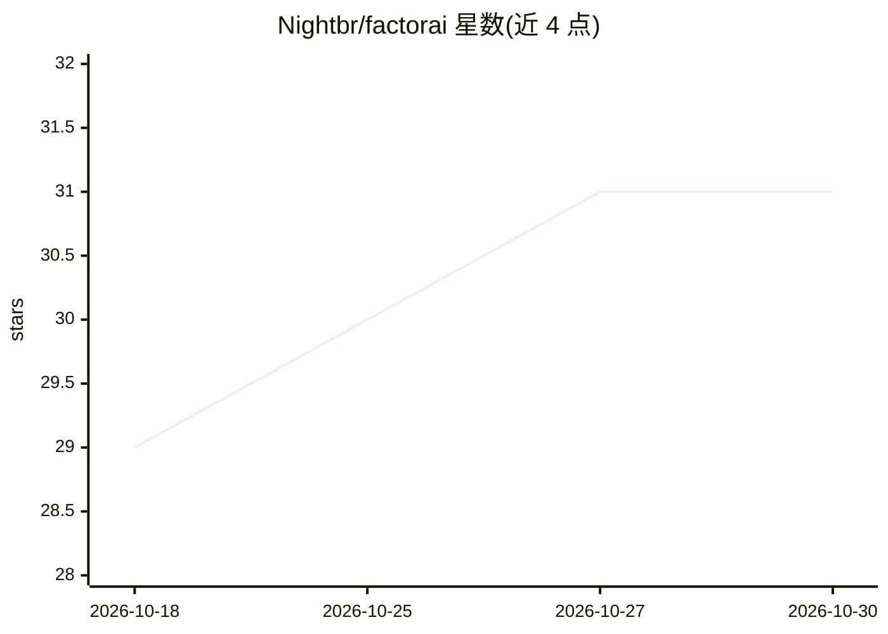

# Nightbr/factorai

⭐ 31 · TypeScript · MIT · 推送 2026-10-16 · [GitHub](https://github.com/Nightbr/factorai) · [官网](https://factorai.build/) · 个人维护

**以会话为单位运行 Claude/Codex CLI 的代理式开发环境**

Rust 编写的桌面端 Agentic Development Environment（ADE）：将每个会话内嵌真实的 claude 或 codex CLI 终端并行运行并显示状态；支持按项目在 cron 上保存提示词的定时例程（Routines）、跨 ~/.claude 与 ~/.codex 的全文检索、集成 Git 变更/diff/提交图，以及项目分组管理。无遥测、无账号、无服务端，驱动已登录的 CLI 且不接触凭证。需本机已安装并登录 Claude Code 或 Codex，状态为 alpha，提供 macOS/Linux/Windows(WSL 2) 安装包。

## 筛选速览

| 维度 | 判定 | 备注 |
|---|---|---|
| AI 角色 | `ai-ecosystem` | LLM/agent 周边工具 |
| 许可风险 | `permissive` | MIT |
| 部署形态 | `desktop` | 安装包/桌面程序 |
| 模型依赖 | — | README 未给出锁定关系 |
| 硬件要求 | — | 无带数字的原话,不猜 |
| 安装摩擦 | `low` | 无编译、无系统依赖或容器化 |
| 成熟度 | `idea` | |

## 能力要点

- 多会话并行运行真实 claude/codex CLI，状态点指示工作中/等待/停止
- 按项目配置 cron 定时提示词例程，关闭期间错过的运行会补跑
- 直接读取 ~/.claude 与 ~/.codex 的全部会话记录做全文搜索，不导入不复制
- 无遥测、无账号、无服务器，本地私有运行

## 适用场景

- 同时监督多个 AI 编码代理会话并审查其改动
- 为项目设置夜间分诊、每周依赖升级等定时代理任务
- 跨项目检索历史代理会话的对话记录

## 场景标签

 · 领域:开发者工具/AI 编码

## 证据(README 行号)

> L30: Each session is the real `claude` or `codex` CLI in a real terminal, and keeps
> L67: No telemetry, no account, no server. factorai drives the CLIs you already

## 星数曲线

2026-10-18 29 → 2026-10-30 31（+2）

---
*卡片 v1 · prompt 1.4 · 生成 2026-10-26 · 置信度 high · 依据 README sha `36d763db85d0` · [字段定义](../../DATASET.md)*
