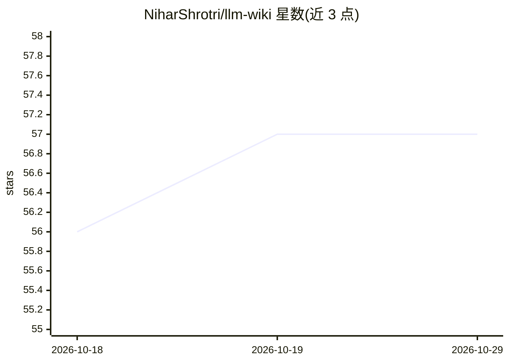

# NiharShrotri/llm-wiki

⭐ 57 · Python · MIT · 推送 2026-04-20 · [GitHub](https://github.com/NiharShrotri/llm-wiki) · 个人维护

**本地 LLM 维护的个人知识库：把文档编译成可查询的 Obsidian wiki**

基于 Karpathy 描述的 LLM-Wiki 模式的本地个人知识库工具：用户投放 PDF/Markdown/HTML/DOCX/TXT 文档，本地 LLM（Ollama + Qwen3-14B）经三遍流水线将其编译为带 YAML frontmatter 与 [[wikilinks]] 交叉链接的 Obsidian wiki（sources/entities/concepts/synthesis 页面），而非查询时从原文检索。查询通过 QMD 做 BM25+向量+LLM 重排的混合检索并生成带引用的回答；提供 lint、自动修复、网页界面与 CLI。要求 Python 3.11+、Node.js 18+、约 12GB 内存与 15GB 磁盘，在 macOS Apple Silicon 上测试，Windows 未测试。

## 筛选速览

| 维度 | 判定 | 备注 |
|---|---|---|
| AI 角色 | `ai-native` | 本体是模型或模型工具 |
| 许可风险 | `permissive` | MIT |
| 部署形态 | `library` | 以包/库形式分发 |
| 模型依赖 | local-ok | 支持本地模型 |
| 硬件要求 | — | 无带数字的原话,不猜 |
| 安装摩擦 | `low` | 无编译、无系统依赖或容器化 |
| 成熟度 | — | 结构信号不足 |

## 能力要点

- 三遍 LLM 摄取流水线生成 sources/entities/concepts 交叉链接页面并智能合并
- BM25+向量+LLM 重排的本地混合检索与带 [[wikilinks]] 引用的回答合成
- wiki lint 健康检查（断链/孤页/矛盾检测）与一键自动修复
- 输出目录即 Obsidian vault，另提供 FastAPI+HTMX 网页界面（含 D3 图谱）

## 适用场景

- 把论文、笔记等资料沉淀为可交叉浏览的 Obsidian 知识库
- 对已编译 wiki 提问并获得带页面引用的合成回答
- 检测知识库中的断链、孤页与页面间矛盾

## 场景标签

`知识库管理` `RAG` `文档问答` · 领域:知识与检索

## 证据(README 行号)

> L3: > A local, LLM-maintained personal knowledge base. Drop documents in, watch an LLM compile them into a living, inter
> L17: Built on the pattern Andrej Karpathy described in his LLM Wiki gist: instead of retrieving from raw documents at qu
> L98: 3. **Synthesis** — Qwen3 writes a cited markdown answer using `[[wikilinks]]` to reference the pages

## 星数曲线

2026-10-18 56 → 2026-10-29 57（+1）

---
*卡片 v1 · prompt 1.4 · 生成 2026-10-24 · 置信度 mid · 依据 README sha `eaf296e386a0` · [字段定义](../../DATASET.md)*
