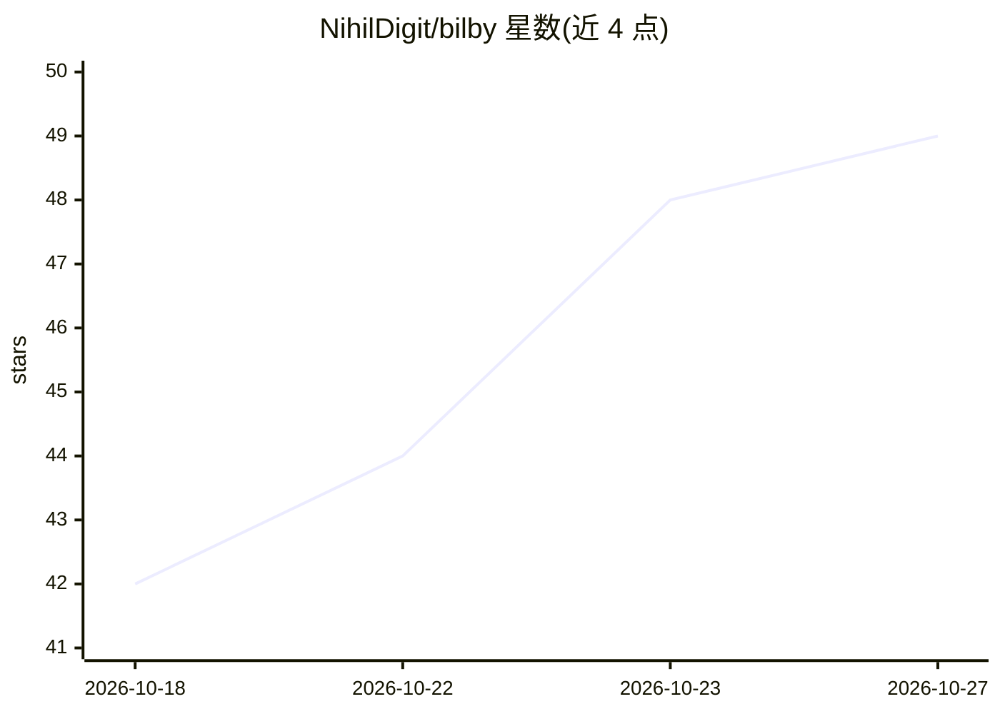

# NihilDigit/bilby

⭐ 49 · Kotlin · GPL-3.0 · 推送 2026-10-22 · [GitHub](https://github.com/NihilDigit/bilby) · 个人维护 · 中文 README

**面向 Android/Windows 的 bilibili 客户端，含 Agentic 检索**

基于 Kotlin Multiplatform 构建的 bilibili 第三方客户端，Android 与 Windows 共用界面与业务代码，遵循 Material 3 Expressive 设计。内容组织以关注动态为主，不提供推荐流；播放页提供基于当前视频的单次检索。听视频功能支持息屏后台、逐句字幕与点句跳转。AI 部分：接入 OpenAI 兼容端点的 Agent 检索，可全站检索并结合简介与热评筛选候选；该功能为可选配置，不影响其他功能使用。

## 筛选速览

| 维度 | 判定 | 备注 |
|---|---|---|
| AI 角色 | `ai-enhanced` | 去掉 AI 部分产品仍成立 |
| 许可风险 | `viral` | GPL-3.0 |
| 部署形态 | `desktop` | 安装包/桌面程序 |
| 模型依赖 | — | README 未给出锁定关系 |
| 硬件要求 | — | 无带数字的原话,不猜 |
| 安装摩擦 | `low` | 无编译、无系统依赖或容器化 |
| 成熟度 | `idea` | |

## 能力要点

- Android/Windows 双端共用代码，Windows 支持 x64/ARM64 安装包与便携版
- 订阅式首页，不提供推荐流
- 听视频支持息屏后台、锁屏控制与逐句字幕点句跳转
- Agent 检索接入 OpenAI 兼容端点，结合简介与热评筛选候选

## 适用场景

- 以订阅流方式浏览已关注 UP 主的动态与视频
- 在通勤或锁屏场景听视频并逐句跟随字幕
- 通过 Agent 基于当前视频检索相关内容

## 场景标签

`语义搜索` · 领域:知识与检索

## 证据(README 行号)

> L16: Bilby 是一款面向 Android 与 Windows 的 bilibili 客户端。
> L44: 支持接入 OpenAI 兼容端点。Agent 检索全站，结合简介与热评筛选候选。
> L66: - **Agent 配置（可选）**：Agent 检索依赖兼容 OpenAI 协议的端点。在应用「设置」→「助理」中填入 API 地址与 Key 即可使用；不配置不影响其他功能。

## 星数曲线

2026-10-18 42 → 2026-10-27 49（+7）

---
*卡片 v1 · prompt 1.4 · 生成 2026-10-25 · 置信度 high · 依据 README sha `ae0545db7d6c` · [字段定义](../../DATASET.md)*
