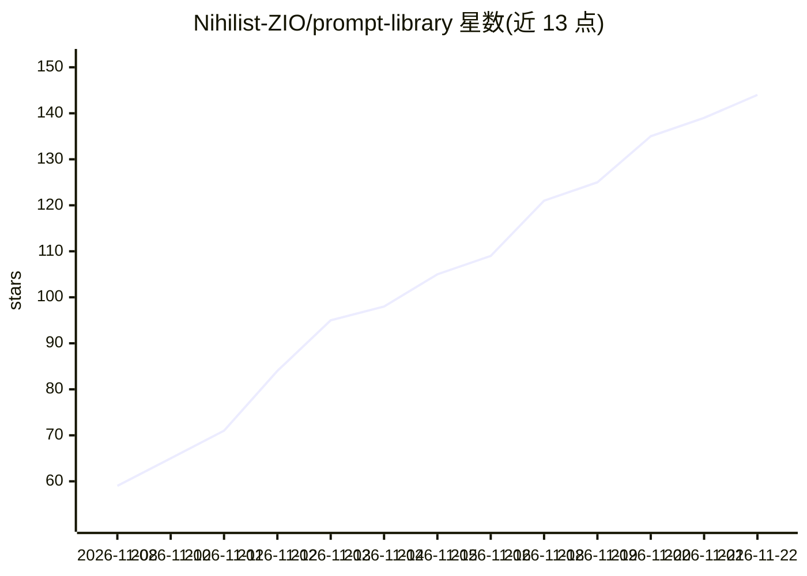

# Nihilist-ZIO/prompt-library

⭐ 144 · Python · MIT · 推送 2026-11-16 · [GitHub](https://github.com/Nihilist-ZIO/prompt-library) · 个人维护 · 中文 README

**AI 图像/视频提示词库：124 条八大类，含索引与入库脚本**

面向普通使用者的 AI 图像/视频生成提示词集合：124 条按人物、场景、构图、特效、周边、艺术、NovelAI、Midjourney 八大类组织，正文原样保留不翻译不改写。提供三种用法：直接取用（Markdown 分类文件、单文件总表、Excel 总表）、把仓库交给 AI Agent 检索库内词条生成新提示词、用 Tensor.Art 语料本地索引逆向构件 tag。附 capabilities.json 能力索引层与 find.py 检索脚本。内容与代码采用双许可。

## 筛选速览

| 维度 | 判定 | 备注 |
|---|---|---|
| AI 角色 | `ai-knowledge` | 知识聚合/清单类 |
| 许可风险 | `permissive` | MIT |
| 部署形态 | `library` | 以包/库形式分发 |
| 模型依赖 | — | README 未给出锁定关系 |
| 硬件要求 | — | 无带数字的原话,不猜 |
| 安装摩擦 | `low` | 无编译、无系统依赖或容器化 |
| 成熟度 | — | 结构信号不足 |

## 能力要点

- 124 条提示词按八大类组织，正文原样保留
- PROMPT_MASTER.md 单文件总表 + Excel 总表双入口
- Tensor.Art 语料本地全文索引（79 篇/3394 行 tag）与离线检索脚本
- capabilities.json 能力索引层与联动配方，支持按能力检索条目

## 适用场景

- 直接复制现成提示词用于 Midjourney / NovelAI / SD 等模型出图
- 把库交给 AI Agent，让它检索并组合出新的提示词
- 逆向日系插画或补齐发型、手部、光影等构件 tag

## 场景标签

`图像生成` · 领域:内容生成

## 证据(README 行号)

> L7: 一套 AI 图像 / 视频生成提示词的开源集合。按 **人物 / 场景 / 构图 / 特效 / 周边 / 艺术 / NovelAI / Midjourney** 八大类组织，正文原样保留，不翻译、不总结、不改写。
> L23: |大类|条数|里面是什么|
> L53: ### 用法 B：让 AI Agent 依据本库生成你想要的提示词

## 星数曲线

2026-11-08 59 → 2026-11-22 144（+85）

---
*卡片 v1 · prompt 1.4 · 生成 2026-11-17 · 置信度 mid · 依据 README sha `a04a1ddb3ae9` · [字段定义](../../DATASET.md)*
