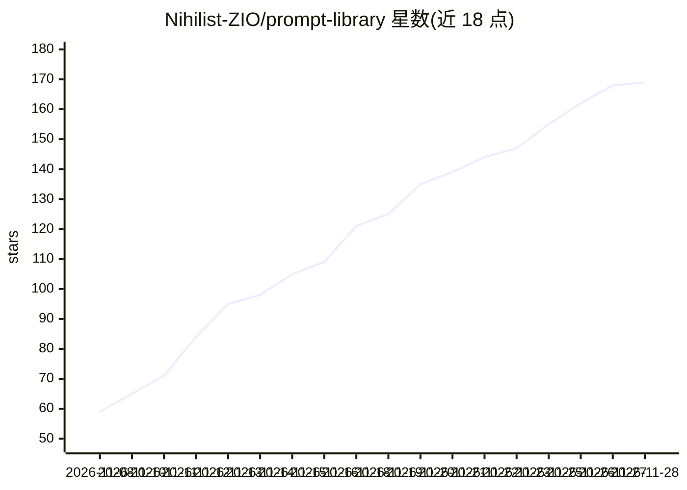

# Nihilist-ZIO/prompt-library

⭐ 169 · Python · MIT · 推送 2026-11-24 · [GitHub](https://github.com/Nihilist-ZIO/prompt-library) · 个人维护 · 中文 README

**给图像/视频生成用户的 138 条提示词库，按八大类组织**

一个 AI 图像/视频生成提示词的开源集合，按人物、场景、构图、特效、周边、艺术、NovelAI、Midjourney 八大类组织，共 138 条，正文原样保留不改写。除直接取用（Markdown 源文件、单文件总表、Excel 总表）外，还提供 Python 检索脚本按能力标签选条目、能力联动配方，以及附带的 Tensor.Art 语料本地全文索引（79 篇）与离线检索脚本，供 AI Agent 逆向构件 tag。依赖仅 Python 标准库加 openpyxl，入库流程含查重与计数校验。

## 筛选速览

| 维度 | 判定 | 备注 |
|---|---|---|
| AI 角色 | `ai-knowledge` | 知识聚合/清单类 |
| 许可风险 | `permissive` | MIT |
| 部署形态 | `library` | 以包/库形式分发 |
| 模型依赖 | — | README 未给出锁定关系 |
| 硬件要求 | — | 无带数字的原话,不猜 |
| 安装摩擦 | `low` | 无编译、无系统依赖或容器化 |
| 成熟度 | — | 结构信号不足 |

## 能力要点

- 138 条提示词按八大类组织，附 Excel 总表与锚点目录
- capabilities.json 能力索引层支持按能力标签检索与联动组合
- 附 Tensor.Art 语料本地全文索引与离线检索脚本
- 入库流程含 difflib 相似度查重与分类计数校验

## 适用场景

- 直接复制现成提示词用于 Midjourney / NovelAI / SD 出图
- 让 AI Agent 基于库内风格语法生成新的完整提示词
- 逆向日系插画时检索发型、手部、光影等构件 tag
- 为电商场景查找白底商品图等品类专用提示词

## 场景标签

`提示工程` `图像生成` `视频生成` · 领域:Agent 开发

## 证据(README 行号)

> L7: 一套 AI 图像 / 视频生成提示词的开源集合。按 **人物 / 场景 / 构图 / 特效 / 周边 / 艺术 / NovelAI / Midjourney** 八大类组织，正文原样保留，不翻译、不总结、不改写。
> L9: **共 138 条。**
> L82: `capabilities.json` + `CAPABILITIES.md` 是**能力索引层**：把全库条目按固定词表打标（用途 / 质感 / 能力 / 模型），并给出常见任务的联动配方。它解决的是「库里有几条」到「库里能干什

## 星数曲线

2026-11-08 59 → 2026-11-28 169（+110）

---
*卡片 v1 · prompt 1.4 · 生成 2026-11-27 · 置信度 mid · 依据 README sha `25973a1cff3d` · [字段定义](../../DATASET.md)*
