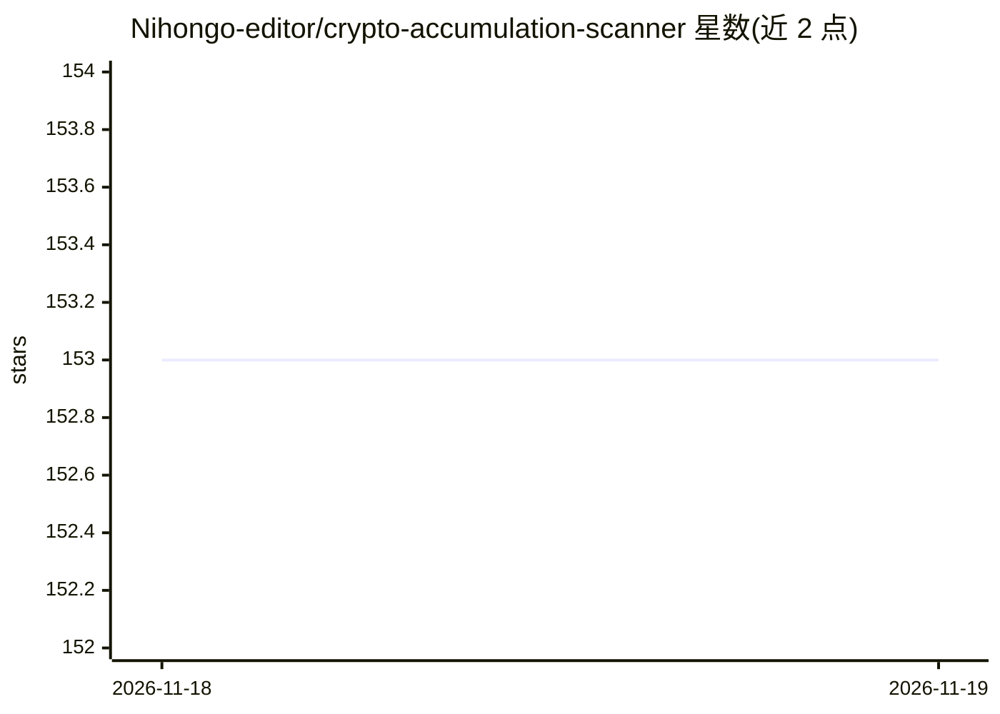

# Nihongo-editor/crypto-accumulation-scanner

⭐ 153 · TypeScript · 推送 2026-11-18 · [GitHub](https://github.com/Nihongo-editor/crypto-accumulation-scanner) · 个人维护

**给加密货币交易者的吸筹形态扫描机器人，定时推送排名候选清单**

运行于 Windows 的社区型加密货币市场扫描工具：识别处于长期平坦底部、波动率压缩的资产，结合成交量、趋势、相对强度与合约资金费率/持仓量做多因子评分，生成排名候选清单，默认每 4 小时通过 Telegram 投递。数据源为 Bybit 公共市场数据（经 ccxt）与 CoinGecko 补充上下文，附带免费新闻/催化剂源、上新公告狙击模式、黑名单与滚动回测、3/7/14 天前瞻测试统计。通过 Telegram/Discord 命令交互（/scan、/score、/stats 等），评分权重可在配置文件中调整。作者声明这是观察清单工具而非交易信号服务。

## 筛选速览

| 维度 | 判定 | 备注 |
|---|---|---|
| AI 角色 | `ai-enhanced` | 去掉 AI 部分产品仍成立 |
| 许可风险 | `none` | — |
| 部署形态 | `None` |  |
| 模型依赖 | — | README 未给出锁定关系 |
| 硬件要求 | — | 无带数字的原话,不猜 |
| 安装摩擦 | `low` | 无编译、无系统依赖或容器化 |
| 成熟度 | `idea` | |

## 能力要点

- 多因子吸筹评分：底部结构、波动率压缩、成交量、相对强度、资金费率/持仓量
- 上新公告狙击模式（约 5 分钟间隔扫描公告源）
- 前瞻测试统计：每条警报在 3/7/14 天后回查实际表现
- 评分权重、扫描频率、新闻源均可在单一配置文件中调整

## 适用场景

- 定时收到加密货币底部吸筹形态的排名候选清单
- 对单个币种做基本面与技术因子深挖（/coin、/score）
- 跟踪历史警报的实际表现以评估扫描质量

## 场景标签

`金融量化` · 领域:学习与行业

## 证据(README 行号)

> L7: Crypto Accumulation Scanner is a community-built tool that quietly watches market for coiling in long, flat bases be
> L151: Every alert is logged and checked 3, 7, and 14 days later. stats command shows how past actually performed, so you

## 星数曲线

2026-11-18 153 → 2026-11-19 153（+0）

---
*卡片 v1 · prompt 1.4 · 生成 2026-11-18 · 置信度 mid · 依据 README sha `83e73c84b40c` · [字段定义](../../DATASET.md)*
