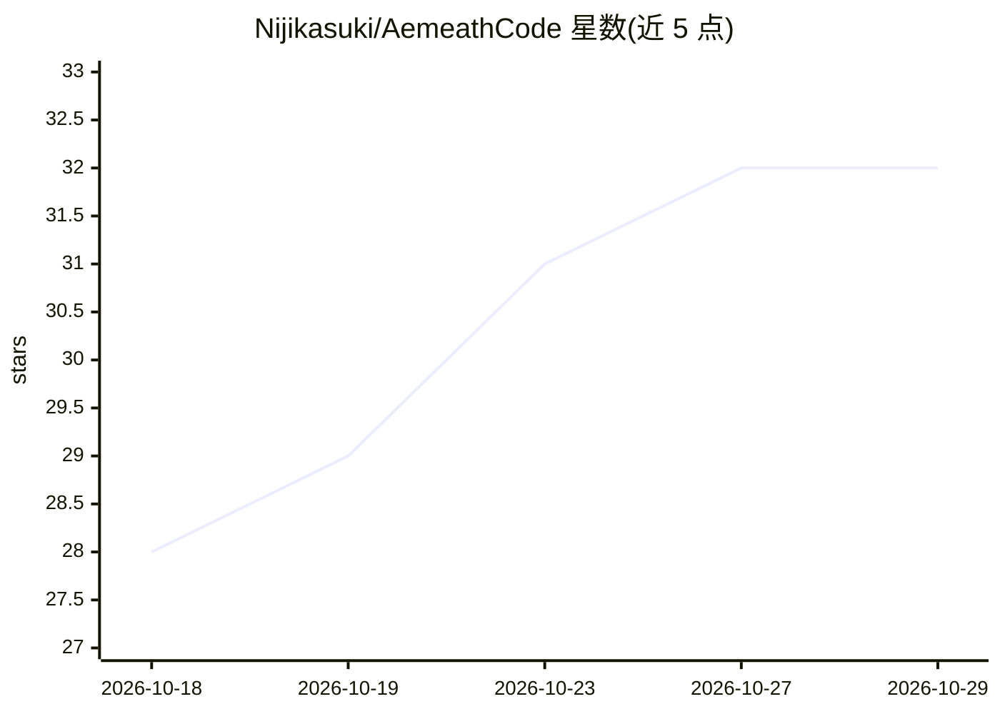

# Nijikasuki/AemeathCode

⭐ 32 · Python · MIT · 推送 2026-10-24 · [GitHub](https://github.com/Nijikasuki/AemeathCode) · [官网](https://nijikasuki.github.io/AemeathCode/) · 个人维护 · 中文 README

**终端 Coding Agent：给定目标后自主规划、读写文件、执行命令直至完成**

纯 Python + asyncio 从零实现的终端 Coding Agent，不依赖任何 agent 框架。由 TUI 前端与后台 daemon 双进程组成，经自实现的 TCP 多路复用协议通信。核心机制包括 ReAct 循环、八类内置工具、三层作用域记忆（run/session/跨 session）、写文件与执行命令前的反向审批、token 预算触发的上下文自动压缩、隔离上下文的子 agent、按需加载的 Skills 与 MCP 客户端。支持 Linux/macOS/Windows+WSL2（Windows 原生明确不支持），通过 uv 一键安装，需配置任意 Anthropic Messages API 兼容端点。项目自我定位为学习与展示型，会真实执行 shell 命令与写文件，需在隔离环境运行。

## 筛选速览

| 维度 | 判定 | 备注 |
|---|---|---|
| AI 角色 | `ai-native` | 本体是模型或模型工具 |
| 许可风险 | `permissive` | MIT |
| 部署形态 | `desktop` | 安装包/桌面程序 |
| 模型依赖 | — | README 未给出锁定关系 |
| 硬件要求 | — | 无带数字的原话,不猜 |
| 安装摩擦 | `low` | 无编译、无系统依赖或容器化 |
| 成熟度 | `idea` | |

## 能力要点

- ReAct 循环、工具注册表、MCP 客户端等全部从零实现，未使用 agent 框架
- 写文件/执行命令前的反向审批面板，显示完整待写内容与命令
- token 预算触发的上下文自动压缩（辅助 LLM 概括，磁盘原始记录不变）
- 三层记忆作用域 + 隔离子 agent + 按需加载 Skills

## 适用场景

- 在终端里让 AI 自主完成编码任务并全程可观察
- 通过 MCP server 与 Skills 扩展 agent 能力边界
- 按 stage-0 到 stage-7 的 git tag 分阶段学习 agent 工程实现

## 场景标签

`编码 Agent` `教程课程` · 领域:编码与开发

## 证据(README 行号)

> L5: **一个从零手搓的 Coding Agent —— 既是能跑的终端 AI Agent,也是一趟看得见的系统工程学习历程。**
> L22: 给它一个目标,它自己规划步骤、读写文件、执行命令、观察结果,循环推进直到做完 —— 全程在终端里看得见。
> L24: 它由两个进程组成:前台界面和后台常驻的 daemon,中间是一条自己实现的多路复用协议。ReAct 循环、工具注册表、会话记忆、权限审批、上下文压缩、子 agent、MCP 客户端,全部用纯 Python + asyncio 从零

## 星数曲线

2026-10-18 28 → 2026-10-29 32（+4）

---
*卡片 v1 · prompt 1.4 · 生成 2026-10-26 · 置信度 high · 依据 README sha `1dd46906d860` · [字段定义](../../DATASET.md)*
