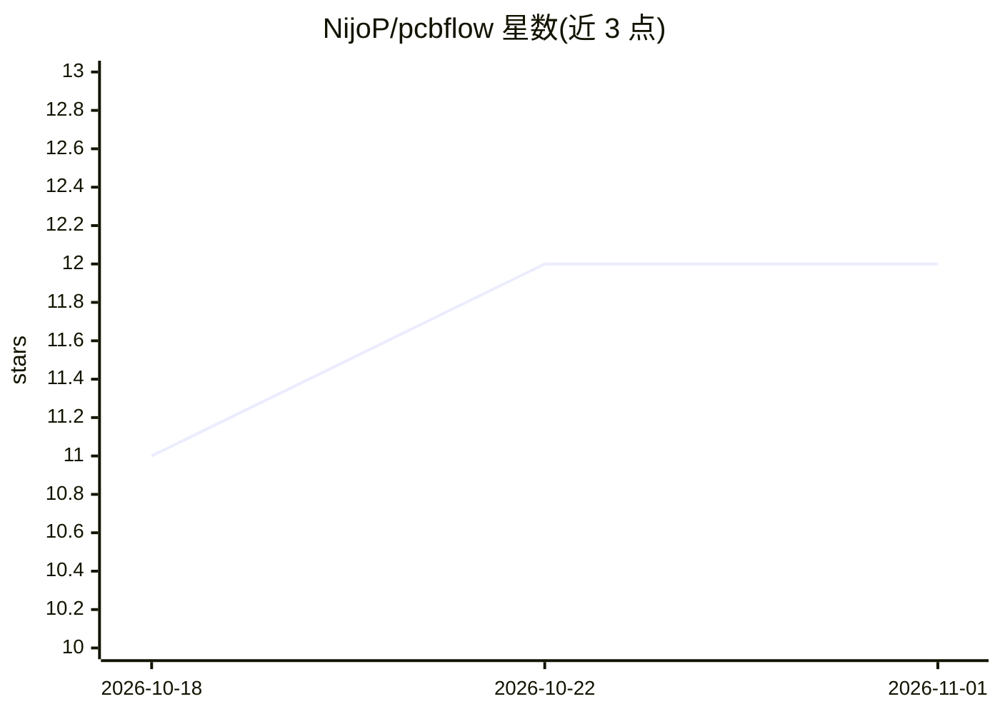

# NijoP/pcbflow

⭐ 12 · Python · MIT · 推送 2026-07-14 · [GitHub](https://github.com/NijoP/pcbflow) · 个人维护

**AI 辅助 PCB 设计工作区：从需求到可制造文件，工程师把关**

面向电子工程师的 AI 辅助 PCB 设计工作区：以仓库中的 Markdown 指令与规则库驱动任意 AI 编码代理（推荐 Claude Code），在 VS Code 中按 12 阶段流程完成原理图生成、元件布局（HPWL 优化）与 IPC 规则驱动布线，衔接 EasyEDA（原理图/布局）与 KiCad（布线/验证）。设两处人工检查点，制造导出被硬性阻断直至 ERC/DRC/DFM 等门禁全部通过且用户批准。需自行安装 VS Code、EasyEDA Pro、KiCad、Chrome、Python 3.9+ 等依赖，无需编程。

## 筛选速览

| 维度 | 判定 | 备注 |
|---|---|---|
| AI 角色 | `ai-ecosystem` | LLM/agent 周边工具 |
| 许可风险 | `permissive` | MIT |
| 部署形态 | `None` |  |
| 模型依赖 | — | README 未给出锁定关系 |
| 硬件要求 | — | 无带数字的原话,不猜 |
| 安装摩擦 | `low` | 无编译、无系统依赖或容器化 |
| 成熟度 | — | 结构信号不足 |

## 能力要点

- 12 阶段设计流程，每阶段带机器计算的门禁检查
- 布线规则引用 IPC-2152/IPC-2221/JLCPCB 来源，线宽按电流推导
- 制造导出硬性阻断：ERC/DRC/DFM/丝印/大电流铺铜全部通过且人工批准
- 含可一条命令复现的端到端参考板示例（DRC-clean + gerbers）

## 适用场景

- 电子工程师用 AI 代理完成重复性原理图/布局/布线工作并保留决策权
- 把硬件项目从需求推进到可制造的工厂文件
- 按 IPC 标准自动校验设计规则后再下板

## 场景标签

 · 领域:电子设计自动化/硬件

## 证据(README 行号)

> L111: PCB Flow is **AI-model-agnostic.** It works with any AI coding assistant that can read
> L121: The framework does not depend on a single AI provider. The instructions live in plain

## 星数曲线

2026-10-18 11 → 2026-11-01 12（+1）

---
*卡片 v1 · prompt 1.4 · 生成 2026-11-01 · 置信度 high · 依据 README sha `cd384ef6f09a` · [字段定义](../../DATASET.md)*
