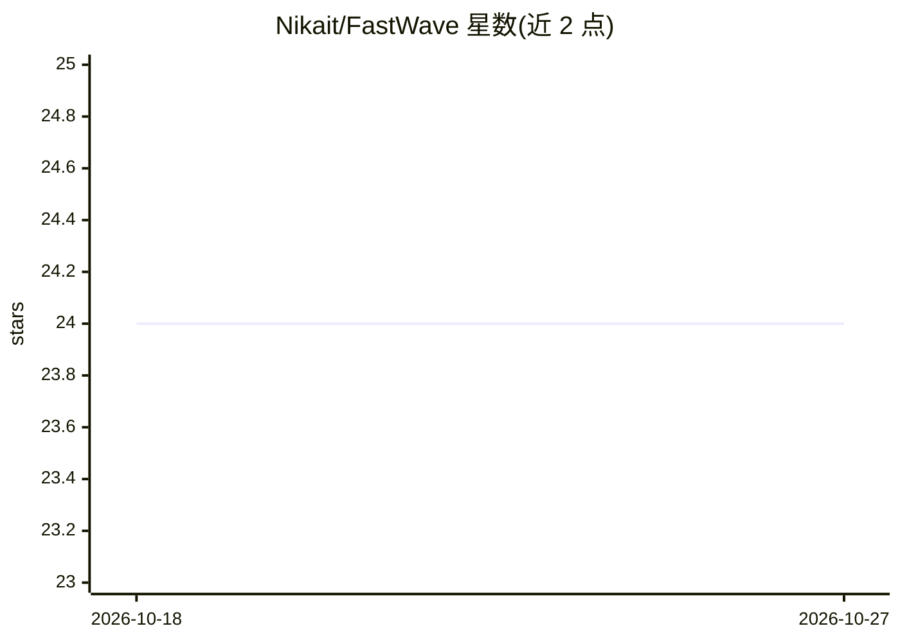

# Nikait/FastWave

⭐ 24 · Python · MIT · 推送 2026-05-16 · [GitHub](https://github.com/Nikait/FastWave) · 个人维护

**轻量扩散模型：音频超分辨率上采样至 48 kHz**

基于 NU-Wave 2 骨干改造的音频超分辨率扩散模型：引入 EDM 显式去噪训练与连续噪声调度（4 或 8 NFE），并以深度可分离卷积和 GRN 替换部分 Conv1d，将参数量降至 1.3 M、每步 FLOPs 降至 12.87 GFLOPs。支持从 8/12/16/24 kHz 上采样到 48 kHz，在 VCTK 数据集上训练与评测，单 GPU 即可训练。提供 conda 环境配置、训练与推理脚本，推理需下载 checkpoint 并配置 inference.yaml。README 未提供 demo 与许可信息。

## 筛选速览

| 维度 | 判定 | 备注 |
|---|---|---|
| AI 角色 | `ai-native` | 本体是模型或模型工具 |
| 许可风险 | `permissive` | MIT |
| 部署形态 | `library` | 以包/库形式分发 |
| 模型依赖 | — | README 未给出锁定关系 |
| 硬件要求 | — | 无带数字的原话,不猜 |
| 安装摩擦 | `low` | 无编译、无系统依赖或容器化 |
| 成熟度 | — | 结构信号不足 |

## 能力要点

- 1.3 M 参数、~50 GFLOPs（4 NFE）实现任意采样率到 48 kHz 的音频超分
- EDM 扩散建模 + ConvNeXtV2（深度可分离卷积与 GRN）架构改动
- 提供预训练 checkpoint 的复现推理流程与训练脚本

## 适用场景

- 把低采样率语音/音频上采样到 48 kHz
- 复现或改进轻量音频超分模型的训练与评测
- 在单 GPU 上做音频带宽扩展实验

## 场景标签

 · 领域:音频/语音处理

## 证据(README 行号)

> L6: FastWave is a lightweight diffusion model for general audio super-resolution (any -> 48 kHz). It matches SOTA qualit
> L38: All models are evaluated on the **VCTK dataset** (48 kHz, 8 speakers test set), measuring upsampling from 8 / 12 / 

## 星数曲线

2026-10-18 24 → 2026-10-27 24（+0）

---
*卡片 v1 · prompt 1.4 · 生成 2026-10-27 · 置信度 mid · 依据 README sha `871f7653803c` · [字段定义](../../DATASET.md)*
