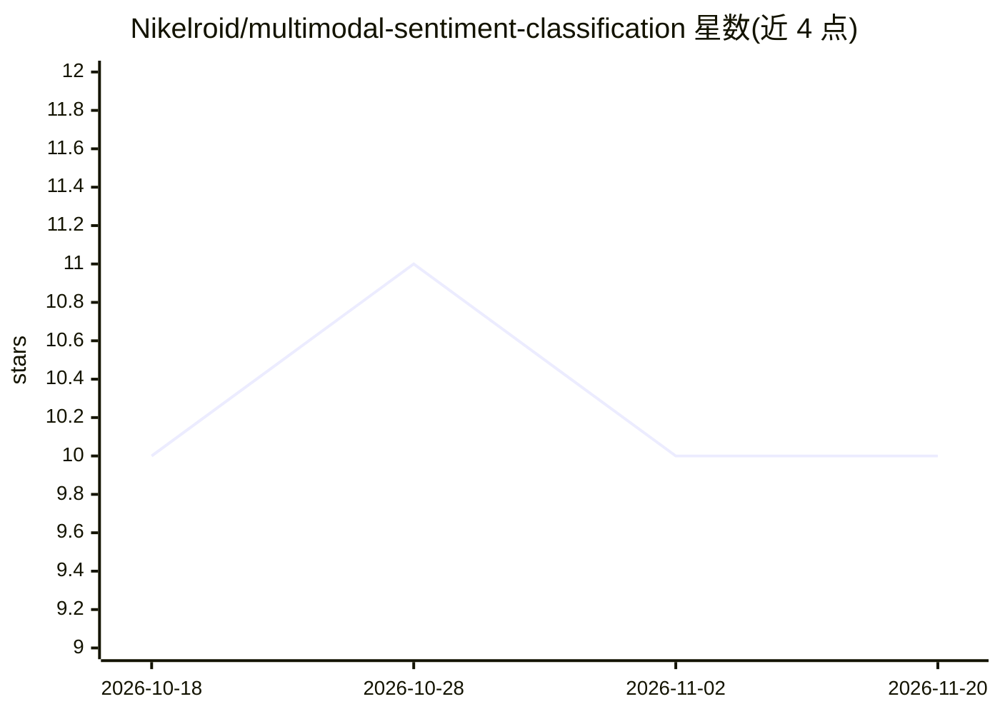

# Nikelroid/multimodal-sentiment-classification

⭐ 10 · Jupyter Notebook · 推送 2026-08-17 · [GitHub](https://github.com/Nikelroid/multimodal-sentiment-classification) · [官网](https://kelidari.com/multimodal-sentiment-classification/#playground) · 个人维护

**多模态情感分类：融合文本/图像/语音的端到端训练与服务仓库**

端到端 MLOps 仓库，从文本、图像、语音输入预测三分类情感（负/中/正）。融合 RoBERTa-large、DINOv2-large 与可选语音分支（Whisper/wav2vec2）经后融合分类；在 MELD 测试集报告 74.5% 准确率，保留 MSCTD 实验作为数据瓶颈研究。提供 pip 安装、训练/评测管线、FastAPI 推理服务、GitHub Actions CI/CD 与 Cloud Run 部署，附浏览器 playground（摄像头/录音采集）与 GitHub Releases 存放检查点。

## 筛选速览

| 维度 | 判定 | 备注 |
|---|---|---|
| AI 角色 | `ai-native` | 本体是模型或模型工具 |
| 许可风险 | `none` | — |
| 部署形态 | `library` | 以包/库形式分发 |
| 模型依赖 | — | README 未给出锁定关系 |
| 硬件要求 | — | 无带数字的原话,不猜 |
| 安装摩擦 | `low` | 无编译、无系统依赖或容器化 |
| 成熟度 | — | 结构信号不足 |

## 能力要点

- 三模态后融合：文本 RoBERTa、图像 DINOv2、可选语音 Whisper
- 置信度调制融合与逐说话人校准（83.2%→91.7%）
- CI/CD 集成：单元测试、GitHub Releases 模型注册、Cloud Run 一键部署
- 附浏览器 playground，支持摄像头与浏览器内录音

## 适用场景

- 训练多模态情感分类模型并复现基准指标
- 通过 FastAPI 端点提供图文（可选语音）情感预测
- 用浏览器 playground 实时测试推理端点

## 场景标签

`多模态` `MLOps` · 领域:感知与多模态

## 证据(README 行号)

> L6: End-to-end MLOps repository for predicting sentiment (Negative / Neutral / Positive)
> L107: * **Multi-Modal Fusion**: text (`RoBERTa-large`), image (`DINOv2-large`), optional audio (`wav2vec2`) — concatenat

## 星数曲线

2026-10-18 10 → 2026-11-20 10（+0）

---
*卡片 v1 · prompt 1.4 · 生成 2026-11-20 · 置信度 high · 依据 README sha `66ac09b246a0` · [字段定义](../../DATASET.md)*
