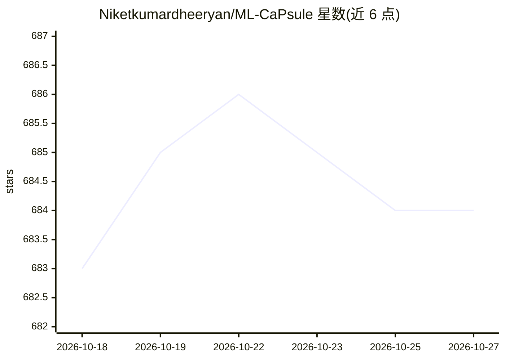

# Niketkumardheeryan/ML-CaPsule

⭐ 684 · Jupyter Notebook · MIT · 推送 2026-09-16 · [GitHub](https://github.com/Niketkumardheeryan/ML-CaPsule) · 组织维护

**面向自学者的机器学习实践项目合集与学习资源库**

开放源码的学习中心，收录 500+ 个机器学习、深度学习、NLP、计算机视觉等领域的真实项目，供无导师指导的初学者与数据科学爱好者通过动手构建学习并准备面试。README 提供先修学习路径（Python 与 R）、主题讲解（数据抽取、可视化、特征选择、统计）、按难度分级的分类/回归/NLP/计算机视觉/聚类/时序/推荐系统数据集清单及下载入口，以及按领域组织的项目索引。技术栈涉及 TensorFlow、PyTorch、scikit-learn、Pandas、OpenCV、R、Power BI、SQL 等。以 GitHub 仓库与网页版形式提供，属策展合集而非可安装运行的单一软件。

## 筛选速览

| 维度 | 判定 | 备注 |
|---|---|---|
| AI 角色 | `ai-knowledge` | 知识聚合/清单类 |
| 许可风险 | `permissive` | MIT |
| 部署形态 | `library` | 以包/库形式分发 |
| 模型依赖 | — | README 未给出锁定关系 |
| 硬件要求 | — | 无带数字的原话,不猜 |
| 安装摩擦 | `low` | 无编译、无系统依赖或容器化 |
| 成熟度 | — | 结构信号不足 |

## 能力要点

- 收录 500+ 个 ML/DL/NLP/CV 真实项目并按领域与难度组织
- 7 大类分级数据集清单（分类/回归/NLP/CV/聚类/时序/推荐）附下载来源
- 提供 Python 与 R 两条先修学习路径及统计与 ML 主题讲解
- 提供网页版项目索引与开源贡献指南

## 适用场景

- 没有导师指导时按项目路径自学机器学习
- 寻找带难度分级的练习数据集（Titanic、MNIST 等）
- 面试前通过真实项目补充实践经验

## 场景标签

`精选清单` `教程课程` · 领域:学习与行业

## 证据(README 行号)

> L32: **ML-CaPsule)** is a comprehensive, open-source learning hub for aspiring and experienced data science enthusiasts.
> L268: ### 🔗 **Browse All 500+ Projects on GitHub →**

## 星数曲线

2026-10-18 683 → 2026-10-27 684（+1）

---
*卡片 v1 · prompt 1.4 · 生成 2026-10-21 · 置信度 mid · 依据 README sha `9519161ecb68` · [字段定义](../../DATASET.md)*
