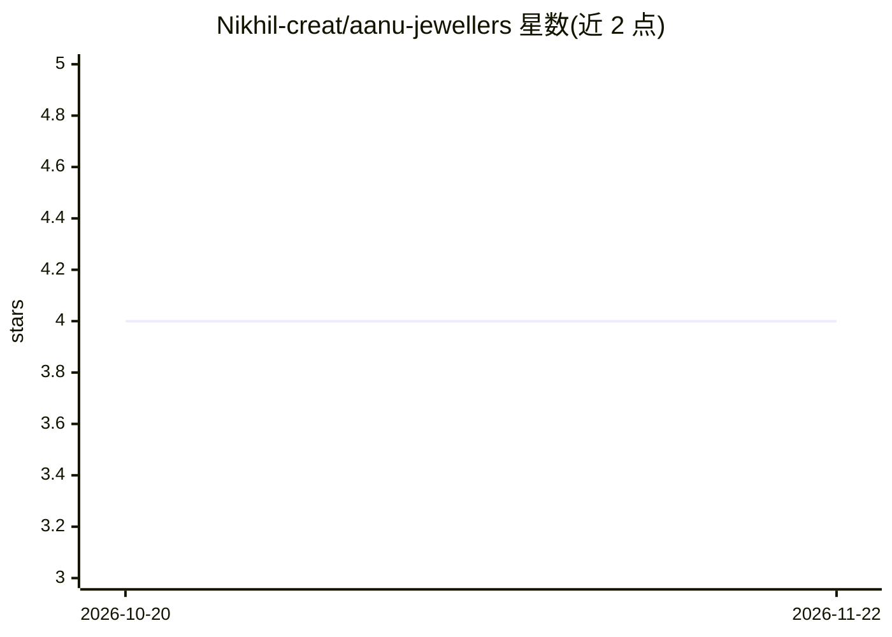

# Nikhil-creat/aanu-jewellers

⭐ — · [GitHub]() · 个人维护

**为珠宝店提供静态网店：价目锁价、3D 展示与 AI 助手**

面向 Thorrur 的 AANU Jewellers 珠宝店的网站项目，主体为可在 GitHub Pages 上运行的静态站点，管理金价/银价行情、下单时锁价、GST 分单票据、印章生成、10000+ 款设计目录与可安装 PWA；可选 Node + Postgres 后端部署在 Vercel/Render/Netlify/Docker，提供数据库订单、管理面板、服务端锁价、Groq 代理与视觉搜索。AI 助手（Groq）与视觉搜索为站点功能之一，无后端时订单经 WhatsApp 发送、票据在浏览器端生成。维护者通过 settings.js、rates.json、products.json 等文件编辑店铺内容。

## 筛选速览

| 维度 | 判定 | 备注 |
|---|---|---|
| AI 角色 | `ai-enhanced` | 去掉 AI 部分产品仍成立 |
| 许可风险 | `none` | — |
| 部署形态 | `desktop` | 安装包/桌面程序 |
| 模型依赖 | locked-api |  |
| 硬件要求 | — | 无带数字的原话,不猜 |
| 安装摩擦 | `low` | 无编译、无系统依赖或容器化 |
| 成熟度 | — | 结构信号不足 |

## 能力要点

- GitHub Pages 可直接运行的静态站点，可选 Node + Postgres 后端
- 金价/银价每克行情更新脚本与下单时锁价票据
- 目录构建工具链：图片转 WebP 多尺寸并生成 products.json，支持 CSV 批量导入
- GST 分单票据与印章（SVG/PNG）生成，支持 docker-compose 部署

## 适用场景

- 给实体珠宝店搭建展示金价与设计目录的线上商店
- 管理金银每日行情并给顾客开具带锁价的 GST 票据
- 用脚本批量导入真实商品照片生成目录

## 场景标签

 · 领域:电商/零售网站

## 证据(README 行号)

> L1: # AANU Jewellers: website
> L3: Static site (works on GitHub Pages) with an optional Node + Postgres backend (Vercel / Render / Netlify / Docker).
> L28: See `.env.example`, `render.yaml`, `vercel.json`, `netlify.toml`, `docker-compose.yml`. Database orders, admin pane

## 星数曲线

2026-10-20 4 → 2026-11-22 4（+0）

---
*卡片 v1 · prompt 1.4 · 生成 2026-11-21 · 置信度 mid · 依据 README sha `c491aae6a11e` · [字段定义](../../DATASET.md)*
