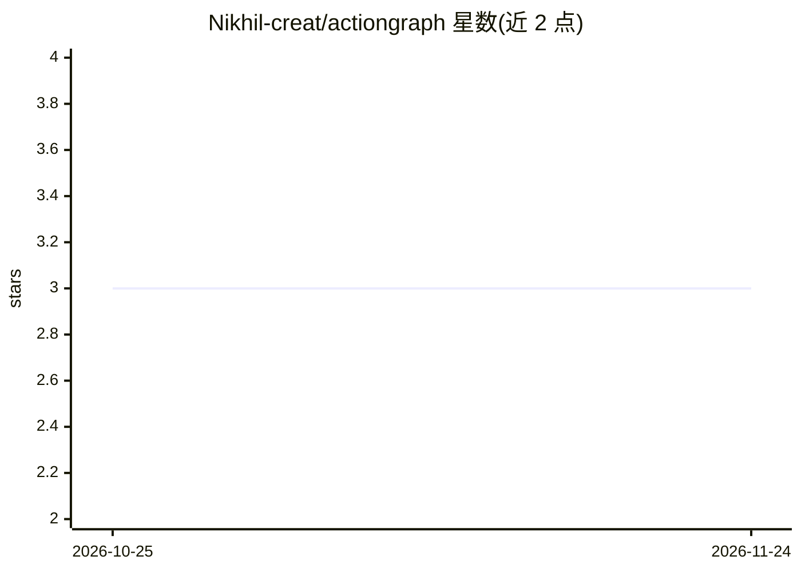

# Nikhil-creat/actiongraph

⭐ 3 · HTML · MIT · 推送 2026-10-20 · [GitHub](https://github.com/Nikhil-creat/actiongraph) · [官网](https://nikhil-creat.github.io/actiongraph/) · 个人维护

**把会议转写稿变成决议、行动项、负责人、期限与风险的 Agent 工具**

静态站点形式的 Agent 流水线工具：粘贴会议转写文本后，由 Extractor（Groq）→ Critic（Gemini）→ Planner（Groq）三段 Agent 处理，带 JSON 自校正与供应商故障切换，输出决策、行动项、负责人、期限与风险。粘贴 Groq 或 Gemini API key 后自动检测供应商并选择模型；内置无 key 可用的离线规则引擎；AI 助手基于转写稿回答并附行号引用。key 仅存于浏览器 localStorage。支持 PWA 安装、.txt/.vtt 上传、CSV/JSON 导出与历史记录，免费部署在 GitHub Pages。

## 筛选速览

| 维度 | 判定 | 备注 |
|---|---|---|
| AI 角色 | `ai-native` | 本体是模型或模型工具 |
| 许可风险 | `permissive` | MIT |
| 部署形态 | `None` |  |
| 模型依赖 | locked-api |  |
| 硬件要求 | — | 无带数字的原话,不猜 |
| 安装摩擦 | `low` | 无编译、无系统依赖或容器化 |
| 成熟度 | — | 结构信号不足 |

## 能力要点

- 三段 Agent 流水线（Groq/Gemini/Groq）与 JSON 自校正、供应商故障切换
- 粘贴 key 即自动检测供应商并选择可用模型
- 无 key 时可用的离线规则引擎
- PWA 安装、.txt/.vtt 上传、CSV/JSON 导出

## 适用场景

- 会后从转写稿整理行动项、负责人与截止期限
- 基于转写内容向 AI 助手提问并核对行号出处
- 无 API key 时用规则引擎做基础提取

## 场景标签

`多智能体` `AI 助手` · 领域:Agent 开发

## 证据(README 行号)

> L3: Agentic AI that turns meeting transcripts into decisions, action items, owners, deadlines and risks.
> L7: - 3-agent pipeline: Extractor (Groq) -> Critic (Gemini) -> Planner (Groq), with JSON self-correction and provider fa
> L10: - Offline rule engine that works with no key

## 星数曲线

2026-10-25 3 → 2026-11-24 3（+0）

---
*卡片 v1 · prompt 1.4 · 生成 2026-11-22 · 置信度 high · 依据 README sha `40c4b39a81d5` · [字段定义](../../DATASET.md)*
