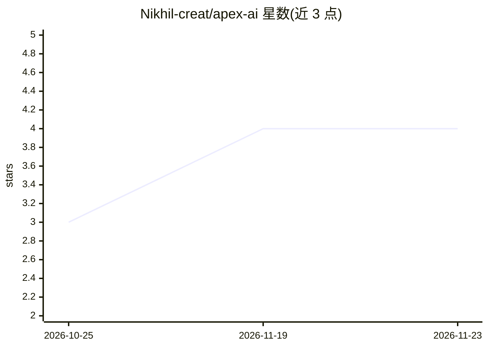

# Nikhil-creat/apex-ai

⭐ 4 · HTML · MIT · 推送 2026-10-12 · [GitHub](https://github.com/Nikhil-creat/apex-ai) · [官网](https://nikhil-creat.github.io/apex-ai/) · 个人维护

**个人开发者构建的多模态 agent AI 助手应用**

面向终端用户提供对话式 AI 助手的聚合项目：通过 LangGraph 编排 agent 流程，Groq 提供 LLM 推理，集成 MCP 工具调用与 GraphRAG（Qdrant + Neo4j）文档检索；另含本地 SLM 分流、自训练 PyTorch/ONNX CNN 图像模型及语音输入输出路由。整个系统由 6 个 Docker 服务组成，部署方式为 docker compose。README 自述多个组件（语音路由、MCP 工具、记忆、遥测等）未经端到端测试，CNN 权重为占位、未训练，Ollama 与流式输出仍在待办清单中。

## 筛选速览

| 维度 | 判定 | 备注 |
|---|---|---|
| AI 角色 | `ai-native` | 本体是模型或模型工具 |
| 许可风险 | `permissive` | MIT |
| 部署形态 | `self-host` | docker 或自建部署 |
| 模型依赖 | locked-api |  |
| 硬件要求 | — | 无带数字的原话,不猜 |
| 安装摩擦 | `low` | 无编译、无系统依赖或容器化 |
| 成熟度 | — | 结构信号不足 |

## 能力要点

- LangGraph + MCP 编排的 agent 助手，LLM 推理由 Groq 提供
- GraphRAG 检索：Qdrant 向量库 + Neo4j 图数据库
- 包含可自行训练的 PyTorch/ONNX CNN 图像模型
- docker compose 一键启动 6 个服务

## 适用场景

- 搭建带工具调用与 GraphRAG 检索的个人 AI 助手
- 对文档做摄取（ingest）后在对话中检索问答
- 本地训练自己的 CNN 图像分类模型

## 场景标签

`AI 助手` `RAG` `文档问答` · 领域:对话与助手

## 证据(README 行号)

> L3: Agentic hybrid multimodal assistant: Groq + LangGraph + MCP, GraphRAG (Qdrant + Neo4j), a custom PyTorch/ONNX CNN, l
> L22: Included but untested end to end: Dockerfiles, `/chat` SSE route, voice routes (`/voice/stt`, `/voice/tts`), MCP to

## 星数曲线

2026-10-25 3 → 2026-11-23 4（+1）

---
*卡片 v1 · prompt 1.4 · 生成 2026-11-21 · 置信度 high · 依据 README sha `1c56931908e0` · [字段定义](../../DATASET.md)*
