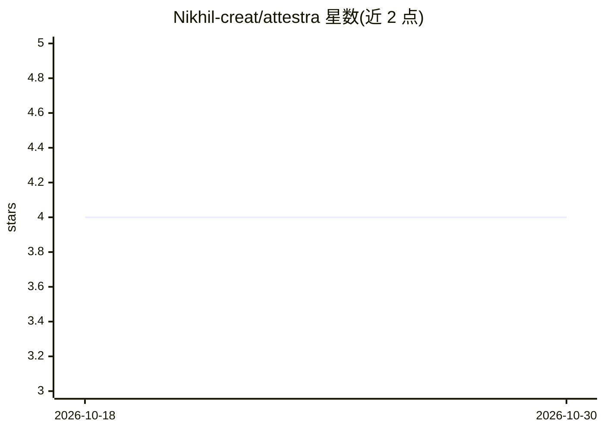

# Nikhil-creat/attestra

⭐ 4 · HTML · MIT · 推送 2026-10-11 · [GitHub](https://github.com/Nikhil-creat/attestra) · [官网](https://nikhil-creat.github.io/attestra/) · 个人维护

**为客户安全问卷起草带引用答案的 AI agent 应用**

面向企业合规场景的 AI 应用：上传自身安全政策文档与问卷 XLSX（支持 SOC 2、SIG、自定义表格），流水线执行 chunk→TF-IDF 检索→LLM 或抽取式起草→critic 校验→人工审批→导出 XLSX。Critic 规则要求无引用、引用越界或来源支持度低的答案转人工，敏感主题一律需人工批准。含答案库复用、PII 脱敏、审计日志、差距分析。MVP 阶段为内存存储、无认证，作者声明不适用于真实客户数据。

## 筛选速览

| 维度 | 判定 | 备注 |
|---|---|---|
| AI 角色 | `ai-native` | 本体是模型或模型工具 |
| 许可风险 | `permissive` | MIT |
| 部署形态 | `None` |  |
| 模型依赖 | — | README 未给出锁定关系 |
| 硬件要求 | — | 无带数字的原话,不猜 |
| 安装摩擦 | `low` | 无编译、无系统依赖或容器化 |
| 成熟度 | `idea` | |

## 能力要点

- 带引用的答案起草（LLM 或离线抽取式双模式）
- critic 校验规则与敏感主题强制人工审批
- PII 脱敏、审计日志、答案库复用与差距分析
- 无 API key 时可离线运行抽取式模式

## 适用场景

- 填写 SOC 2 / SIG 等客户安全问卷时从自有政策生成带引用的草稿
- 复用已批准答案应对重复问卷问题
- 通过差距分析发现政策未覆盖的问卷问题

## 场景标签

`文档问答` · 领域:知识与检索

## 证据(README 行号)

> L5: AI agents that draft **cited** answers to customer security questionnaires (SOC 2, SIG, custom spreadsheets) from yo
> L36: `chunk -> retrieve (TF-IDF) -> draft (LLM or extractive) -> critic -> approve -> export`

## 星数曲线

2026-10-18 4 → 2026-10-30 4（+0）

---
*卡片 v1 · prompt 1.4 · 生成 2026-10-18 · 置信度 high · 依据 README sha `bfeb3dea21d0` · [字段定义](../../DATASET.md)*
