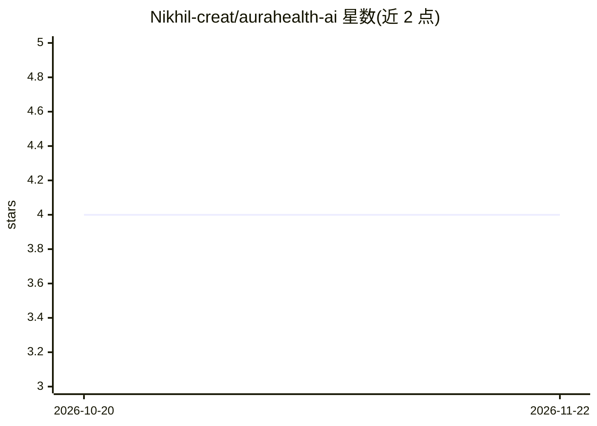

# Nikhil-creat/aurahealth-ai

⭐ — · [GitHub]() · 个人维护

**面向个人用户的 AI 健康健身应用：食物扫描与多智能体教练**

AuraHealth AI 是一个健康与健身应用套件，包含 BMI/TDEE 计算器、基于 CNN + RAG 的食物扫描、三智能体 AI 教练、带记忆的聊天助手，以及离线 PWA。提供两种形态：docs/ 目录的 GitHub Pages 静态版（含指标、食物矩阵、训练、恢复等页面），以及 fullstack/ 目录的 Docker 全栈版（FastAPI、LangGraph、ChromaDB、Postgres、Redis、Node 同步、Prometheus、Grafana）。在设置中粘贴免费 Groq key 可启用 LLM 智能体与助手。README 还给出从 Termux 发布静态版的流程。

## 筛选速览

| 维度 | 判定 | 备注 |
|---|---|---|
| AI 角色 | `ai-native` | 本体是模型或模型工具 |
| 许可风险 | `none` | — |
| 部署形态 | `desktop` | 安装包/桌面程序 |
| 模型依赖 | locked-api |  |
| 硬件要求 | — | 无带数字的原话,不猜 |
| 安装摩擦 | `low` | 无编译、无系统依赖或容器化 |
| 成熟度 | — | 结构信号不足 |

## 能力要点

- CNN + RAG 食物扫描功能
- 三智能体（3-agent）AI 教练与带记忆的助手
- 离线可用的 PWA 形态
- Docker 全栈版含 FastAPI、LangGraph、ChromaDB、Postgres、Redis 等组件

## 适用场景

- 记录与追踪健康指标、训练与恢复进度
- 扫描食物获取营养分析
- 通过 AI 教练获得训练与饮食指导

## 场景标签

`多智能体` `聊天机器人` `RAG` · 领域:Agent 开发

## 证据(README 行号)

> L2: - `docs/` live app for GitHub Pages (metrics, foods matrix, training, steps, progress and recovery, CNN + RAG food s
> L13: Then open the app, go to Settings and paste a free Groq key to switch on the LLM agents and assistant.

## 星数曲线

2026-10-20 4 → 2026-11-22 4（+0）

---
*卡片 v1 · prompt 1.4 · 生成 2026-11-21 · 置信度 high · 依据 README sha `d634374997b5` · [字段定义](../../DATASET.md)*
