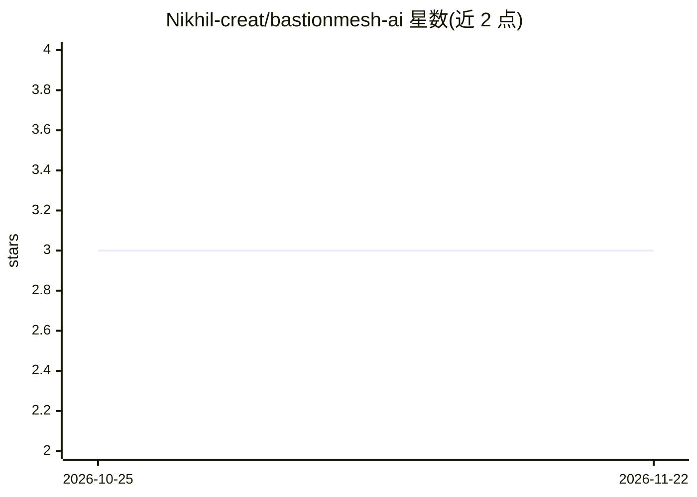

# Nikhil-creat/bastionmesh-ai

⭐ 3 · Python · MIT · 推送 2026-10-18 · [GitHub](https://github.com/Nikhil-creat/bastionmesh-ai) · [官网](https://nikhil-creat.github.io/bastionmesh-ai/) · 个人维护

**多智能体共识网格：CNN 视觉异常检测 + 纠正式 RAG + 审计账本**

以 Docker Compose 编排的多智能体系统：视觉侧用 ResNet-50 做无标注异常检测（Welford 基线 + Mahalanobis 异常图 + 原型分类），LangGraph 智能体执行带 HITL 审批门的纠正式 Agentic RAG（Qdrant 混合检索 + cross-encoder），投票经 HMAC 签名后由 Raft 风格加权共识（阈值 0.66 + 50% 参与）裁决，动作写入哈希链审计账本。LLM 为可选项：无 LLM_BASE_URL 时走抽取式回答。附 GitHub Pages 文档站与解释 API。

## 筛选速览

| 维度 | 判定 | 备注 |
|---|---|---|
| AI 角色 | `ai-native` | 本体是模型或模型工具 |
| 许可风险 | `permissive` | MIT |
| 部署形态 | `self-host` | docker 或自建部署 |
| 模型依赖 | — | README 未给出锁定关系 |
| 硬件要求 | — | 无带数字的原话,不猜 |
| 安装摩擦 | `low` | 无编译、无系统依赖或容器化 |
| 成熟度 | — | 结构信号不足 |

## 能力要点

- ResNet-50 在线基线学习，无需标注数据即可输出异常图与置信度
- HMAC 签名投票 + 加权共识，CRITICAL 提案强制 HITL 审批门
- SHA-256 哈希链审计账本与 /audit/verify 校验端点
- LLM 可选：配置 OpenAI 兼容服务即可生成式回答，否则抽取式回答

## 适用场景

- 对视频流做无标注异常检测并输出边界框
- 构建带人工审批与审计留痕的智能体决策流程
- 多智能体提案投票与 fail-safe 超时治理

## 场景标签

`多智能体` `RAG` `目标检测` · 领域:Agent 开发

## 证据(README 行号)

> L5: Autonomous multi-agent mesh: PyTorch CNN vision → LangGraph agents (with HITL) → Corrective Agentic RAG over Qdrant 
> L23: Frames pass through ResNet-50; a fixed-seed 2048→512 projection gives per-location embeddings. A streaming baseline
> L44: - Without `LLM_BASE_URL` CRAG answers are extractive (top refined sentences); with it, any OpenAI-compatible server

## 星数曲线

2026-10-25 3 → 2026-11-22 3（+0）

---
*卡片 v1 · prompt 1.4 · 生成 2026-11-22 · 置信度 high · 依据 README sha `14a8a9f4fd13` · [字段定义](../../DATASET.md)*
