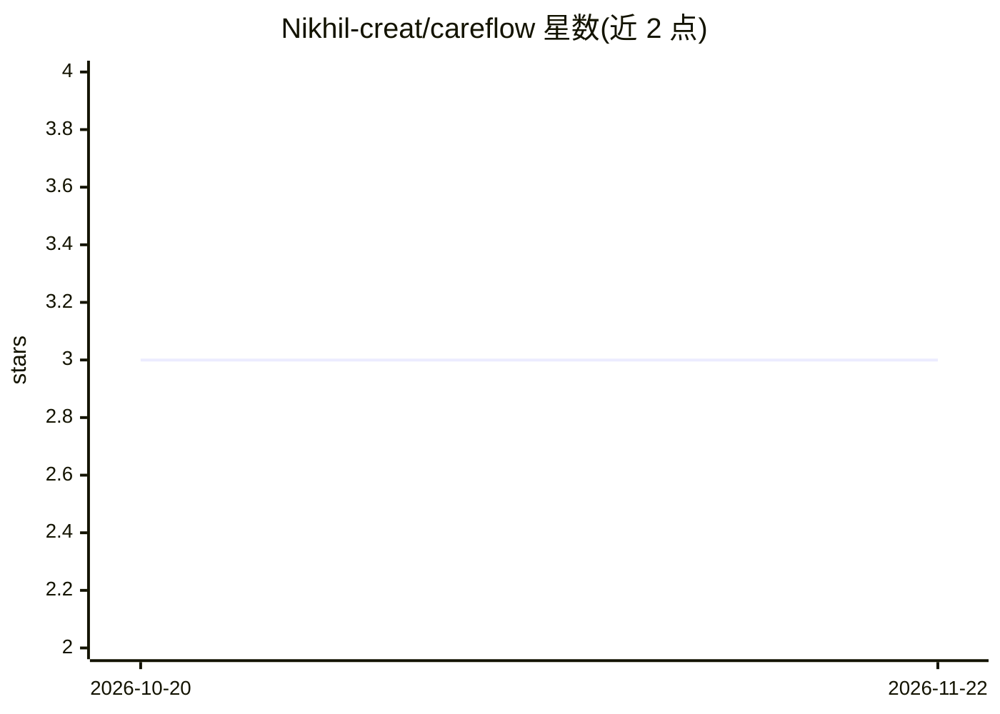

# Nikhil-creat/careflow

⭐ 3 · Python · 推送 2026-10-11 · [GitHub](https://github.com/Nikhil-creat/careflow) · [官网](https://nikhil-creat.github.io/careflow/) · 个人维护

**医院管理自动化演示项目：分诊、预约、床位与药房代理**

面向医院管理流程的演示项目，明确声明仅使用虚构数据、非 HIPAA/DPDP 合规、禁止录入真实患者数据。功能包括分诊/床位/药房/计费自动化、患者风险评分、AI 导诊聊天机器人（急诊检测、症状转科室、预约）、带确认信息的预约自动化与提醒代理。后端为 FastAPI，代理循环可用 Groq 或 Claude 的 tool-use，也可在无 API key 时以规则模式运行；支持 Docker Compose、GitHub Pages 前端与 Render 免费层部署，v2 起含分析、营销、实验室排队与员工排班。

## 筛选速览

| 维度 | 判定 | 备注 |
|---|---|---|
| AI 角色 | `ai-native` | 本体是模型或模型工具 |
| 许可风险 | `none` | — |
| 部署形态 | `desktop` | 安装包/桌面程序 |
| 模型依赖 | locked-api |  |
| 硬件要求 | — | 无带数字的原话,不猜 |
| 安装摩擦 | `low` | 无编译、无系统依赖或容器化 |
| 成熟度 | — | 结构信号不足 |

## 能力要点

- 床位/药房/计费/风险四类代理，按 plan-act-observe 循环运行
- Groq（Llama）或 Claude tool-use 代理循环，无 key 时回退规则模式
- 预约确认单含 .ics 日历、WhatsApp/SMS/打印按钮与提醒代理
- PWA 可安装、离线可用、暗色模式，Telugu/Hindi/English 多语言回复

## 适用场景

- 部署医院管理自动化的演示环境
- 体验分诊聊天机器人与症状转科室路由
- 在免费层托管（GitHub Pages + Render）跑通前后端

## 场景标签

`聊天机器人` `工作流自动化` · 领域:效率与自动化

## 证据(README 行号)

> L1: # CareFlow: AI Hospital Management Automation
> L9: - FastAPI backend with a Groq (free) or Claude tool-use agent loop (works without a key using rules)
> L49: - Free Groq AI: create a free key at https://console.groq.com/keys, open the app, go to Settings, paste it and Save

## 星数曲线

2026-10-20 3 → 2026-11-22 3（+0）

---
*卡片 v1 · prompt 1.4 · 生成 2026-11-22 · 置信度 high · 依据 README sha `6cce82039322` · [字段定义](../../DATASET.md)*
