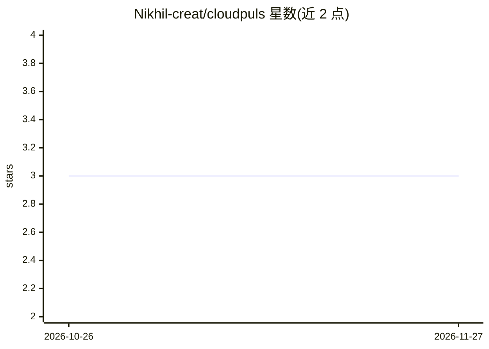

# Nikhil-creat/cloudpuls

⭐ 3 · JavaScript · MIT · 推送 2026-11-12 · [GitHub](https://github.com/Nikhil-creat/cloudpuls) · [官网](https://cloudpuls.23641a05k6.workers.dev/) · 个人维护

**面向云运维的多云 FinOps 与安全自动修复 AI 平台**

部署在 Vercel/Cloudflare Pages/Render 或 Docker 的多云 FinOps 平台：EWMA 成本预测与异常检测、LLM 防火墙与 TOTP MFA、LangGraph 多智能体（含 policy-as-code 评审与自纠错）、Qdrant 检索的 corrective RAG、PyTorch CNN 热图分类器。提供 MCP 端点（list_resources 等 4 个工具），Studio 支持从提示构建应用、生成图像与联网调研。需自备 Groq/Gemini API key；README 说明哈希嵌入器 recall@3 为 0.875，部分组件未经真实环境运行验证。

## 筛选速览

| 维度 | 判定 | 备注 |
|---|---|---|
| AI 角色 | `ai-native` | 本体是模型或模型工具 |
| 许可风险 | `permissive` | MIT |
| 部署形态 | `self-host` | docker 或自建部署 |
| 模型依赖 | locked-api |  |
| 硬件要求 | — | 无带数字的原话,不猜 |
| 安装摩擦 | `low` | 无编译、无系统依赖或容器化 |
| 成熟度 | — | 结构信号不足 |

## 能力要点

- MCP 端点暴露 4 个工具，审批操作不对外暴露
- Corrective RAG：Qdrant 检索+相关性评分+查询改写重试
- LLM 防火墙、注入围栏、TOTP MFA 与哈希链审计日志
- Studio 支持提示生成应用、图像生成与带来源的研究

## 适用场景

- 多云环境下的成本预测与异常告警
- 通过人工审批的 agent 流程执行安全自动修复
- 部署带 LLM 防火墙的网站助手

## 场景标签

`Agent 框架` `多智能体` `RAG` `聊天机器人` · 领域:Agent 开发

## 证据(README 行号)

> L3: Agentic multi-cloud FinOps, security auto-remediation and AI observability. MCP-native, with corrective RAG, a CNN a
> L21: - **Corrective RAG:** Qdrant retrieval, relevance grading, query rewrite and retry, seeded runbook knowledge base, 
> L55: frontend/          Next.js 14 console: Overview, Copilot, Alerts, Plans, Security (MFA)

## 星数曲线

2026-10-26 3 → 2026-11-27 3（+0）

---
*卡片 v1 · prompt 1.4 · 生成 2026-11-23 · 置信度 mid · 依据 README sha `d6e8368a4a88` · [字段定义](../../DATASET.md)*
