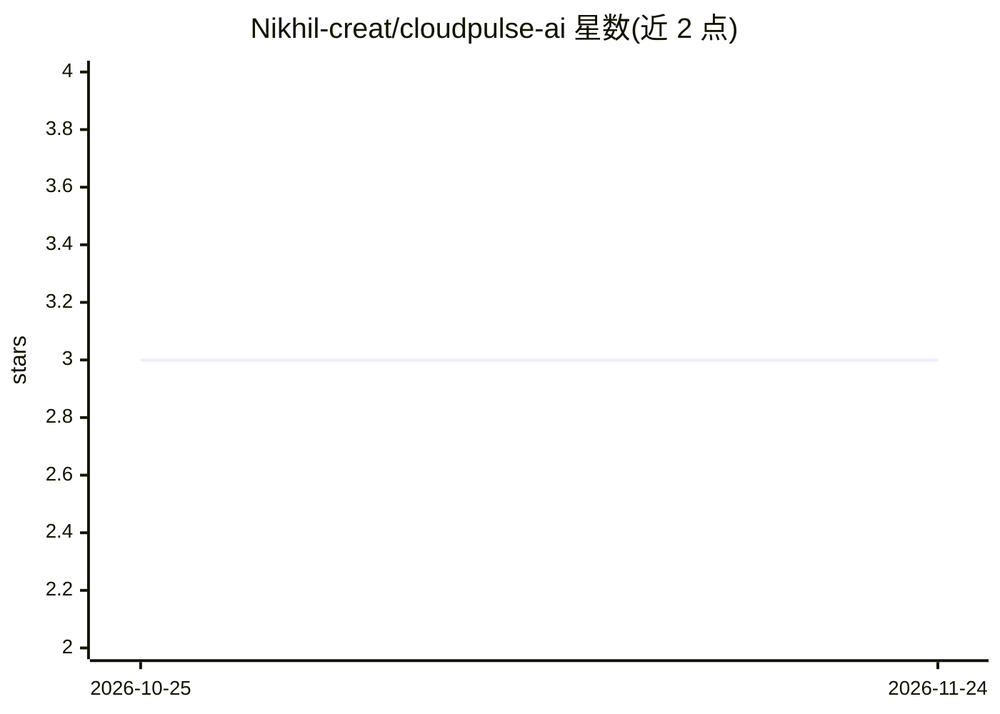

# Nikhil-creat/cloudpulse-ai

⭐ 3 · Python · MIT · 推送 2026-11-12 · [GitHub](https://github.com/Nikhil-creat/cloudpulse-ai) · [官网](https://cloudpuls.23641a05k6.workers.dev/#top) · 个人维护

**多云 FinOps 与安全自动修复的 AI 平台，供云运维团队使用**

基于 FastAPI 与 LangGraph agent 集群的多云平台，覆盖 FinOps 成本预测（EWMA、z-score 异常）、安全自动修复（人工审批 Terraform 修复）与 AI 可观测性。机制包括 Qdrant 纠错式 RAG 运行手册知识库、PyTorch CNN 热图异常分类器、Groq/Gemini LLM 网关与 LLM 防火墙、MCP server（不暴露 approve/apply 工具）。README 自述部分组件（Docker、Next.js、实时 LLM 调用）未在构建环境中运行验证，LLM 价格为占位值。

## 筛选速览

| 维度 | 判定 | 备注 |
|---|---|---|
| AI 角色 | `ai-native` | 本体是模型或模型工具 |
| 许可风险 | `permissive` | MIT |
| 部署形态 | `self-host` | docker 或自建部署 |
| 模型依赖 | locked-api |  |
| 硬件要求 | — | 无带数字的原话,不猜 |
| 安装摩擦 | `low` | 无编译、无系统依赖或容器化 |
| 成熟度 | — | 结构信号不足 |

## 能力要点

- LangGraph agent 集群含策略 critic 与一轮自我修正，Redis 存对话记忆
- 纠错式 RAG：Qdrant 检索、相关性分级、查询重写与重试
- PyTorch CNN 热图分类器附训练脚本，站点展示 layer-1 特征图
- 人工审批的 Terraform 修复与哈希链审计日志

## 适用场景

- 管理多云成本预测与月末支出预估
- 通过人工审批流程执行安全修复计划
- 用运行手册知识库回答云运维问题
- 通过 MCP 接口查询资源、指标与告警

## 场景标签

`RAG` `LLM 可观测性` `网络安全` · 领域:评测与运维

## 证据(README 行号)

> L3: Agentic multi-cloud FinOps, security auto-remediation and AI observability. MCP-native, with corrective RAG, a CNN a
> L17: - **Agentic AI:** LangGraph swarm with a policy-as-code critic and one self-correction pass; conversation memory in
> L18: - **Corrective RAG:** Qdrant retrieval, relevance grading, query rewrite and retry, seeded runbook knowledge base, 

## 星数曲线

2026-10-25 3 → 2026-11-24 3（+0）

---
*卡片 v1 · prompt 1.4 · 生成 2026-11-22 · 置信度 high · 依据 README sha `fffdc9f1df72` · [字段定义](../../DATASET.md)*
