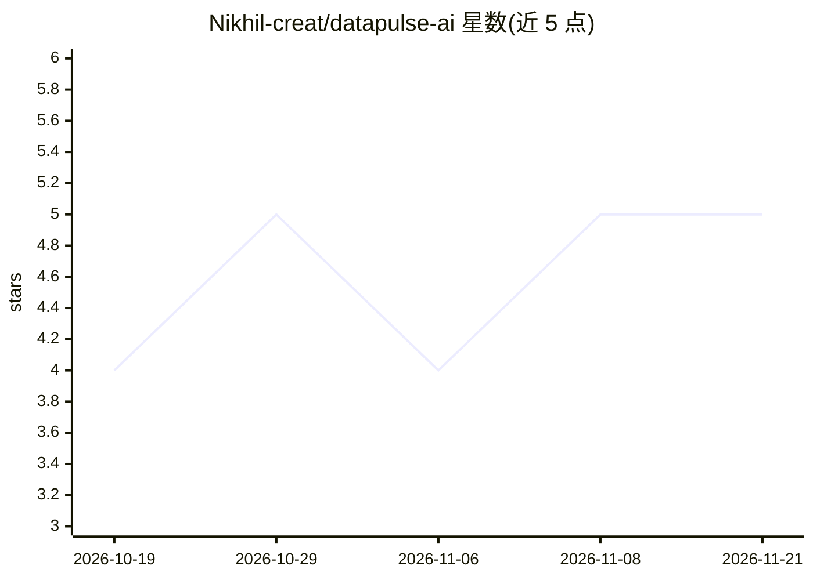

# Nikhil-creat/datapulse-ai

⭐ 5 · HTML · 推送 2026-10-06 · [GitHub](https://github.com/Nikhil-creat/datapulse-ai) · [官网](https://nikhil-creat.github.io/datapulse-ai/) · 个人维护

**个人作品集与数据科学任务控制台，内含 AI 助手**

静态部署的作品集与任务控制台：Nova 助手支持离线作品集问答及 Groq 工具调用 agent，附带 Agent Missions、CSV 数据实验台（Data Lab）、RAG Vault、浏览器内运行的 CNN、终端与实时 GitHub 统计。通过在设置页添加 Groq API key 使用模型，key 仅存于浏览器；模型列表从 key 自动检测，README 注明 llama-3.3-70b-versatile 已被 Groq 于 2026-08-16 退役。支持 GitHub Pages 部署或 Docker 运行。

## 筛选速览

| 维度 | 判定 | 备注 |
|---|---|---|
| AI 角色 | `ai-enhanced` | 去掉 AI 部分产品仍成立 |
| 许可风险 | `none` | — |
| 部署形态 | `self-host` | docker 或自建部署 |
| 模型依赖 | locked-api |  |
| 硬件要求 | — | 无带数字的原话,不猜 |
| 安装摩擦 | `low` | 无编译、无系统依赖或容器化 |
| 成熟度 | — | 结构信号不足 |

## 能力要点

- Nova 助手：离线作品集问答 + Groq 工具调用 agent
- RAG Vault 与 CSV Data Lab 数据分析功能
- 浏览器内运行的 CNN 模型
- 模型从 Groq key 自动检测

## 适用场景

- 展示个人数据科学与 AI 项目作品集
- 在浏览器中对 CSV 数据做实验分析
- 通过助手查询作品集相关问答

## 场景标签

`数据分析` `AI 助手` `RAG` · 领域:效率与自动化

## 证据(README 行号)

> L2: Static portfolio and mission control: Nova assistant (offline portfolio Q&A, plus Groq tool-calling agent), Agent Mi
> L3: Add a free Groq key in Settings (https://console.groq.com/keys). It stays in your browser. Never commit keys.

## 星数曲线

2026-10-19 4 → 2026-11-21 5（+1）

---
*卡片 v1 · prompt 1.4 · 生成 2026-11-21 · 置信度 high · 依据 README sha `32ff7cc1c86e` · [字段定义](../../DATASET.md)*
