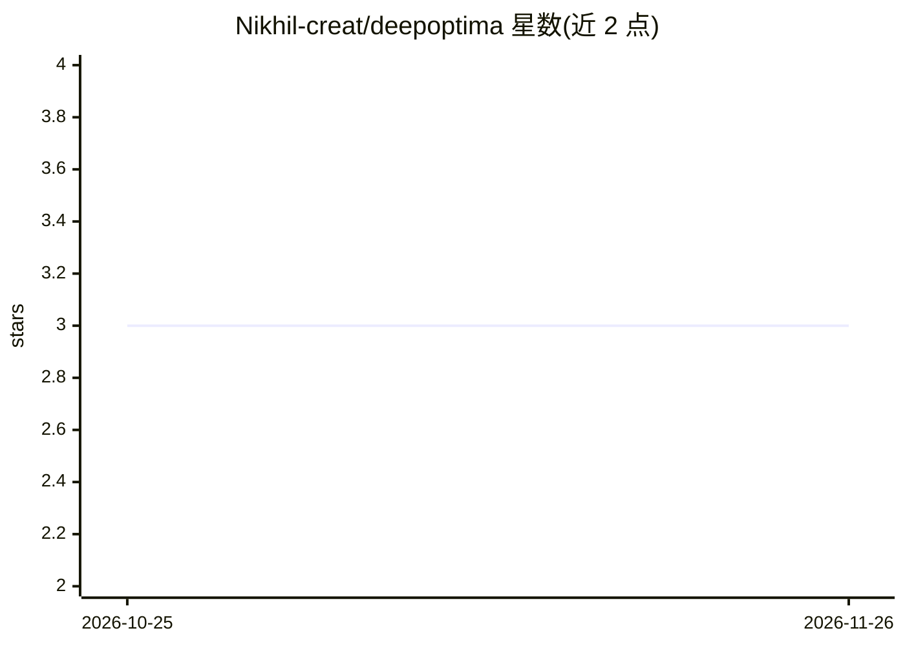

# Nikhil-creat/deepoptima

⭐ 3 · TypeScript · MIT · 推送 2026-10-27 · [GitHub](https://github.com/Nikhil-creat/deepoptima) · [官网](https://deepoptima.vercel.app) · 个人维护

**表格数据 AutoML 平台：上传 CSV 自动搜索模型**

DeepOptima Studio 是面向表格数据的 AutoML 平台：用户注册后上传 CSV、选择预测列，系统用 NSGA-II 多目标进化搜索（同时优化验证分数、每千条预测耗时与模型体积）尝试数百个模型，输出帕累托前沿模型、基线对比、95% 置信区间、特征重要性、可下载的 model.joblib 与 predict.py，并提供 API key 供外部调用与只读分享链接。技术栈为 FastAPI + Postgres/SQLite + React，支持 Docker 部署；仓库还保留了早期面向研究的分布式 PyTorch NAS 平台（agent swarm、MCP server、Wasm sandbox、mTLS）。作者声明 HTTP API 与前端层端到端测试尚未在沙箱中完成验证。

## 筛选速览

| 维度 | 判定 | 备注 |
|---|---|---|
| AI 角色 | `ai-native` | 本体是模型或模型工具 |
| 许可风险 | `permissive` | MIT |
| 部署形态 | `library` | 以包/库形式分发 |
| 模型依赖 | — | README 未给出锁定关系 |
| 硬件要求 | — | 无带数字的原话,不猜 |
| 安装摩擦 | `low` | 无编译、无系统依赖或容器化 |
| 成熟度 | `idea` | |

## 能力要点

- NSGA-II 多目标进化搜索，兼顾准确率、预测速度与模型体积
- 输出可下载模型文件与 predict.py，附个人 API key 调用
- CSV 自动剖析（列类型、缺失值、ID 类列检测）
- 站点管理员面板：用户管理、配额、限流

## 适用场景

- 给表格数据自动训练分类/回归模型并比较多种取舍
- 把训练好的模型通过 API 接入自己的应用
- 需要下载 predict.py 在本地做批量预测

## 场景标签

`MLOps` `数据分析` · 领域:效率与自动化

## 证据(README 行号)

> L5: **Free, private AutoML for your spreadsheets.** Create an account, upload a CSV, choose the column to predict, and a
> L12: 3. **Create an experiment**: target column, problem type (auto), scoring metric, model families (linear, tree, rand
> L52: The earlier DeepOptima AI platform (distributed PyTorch NAS, agent swarm, MCP server, Wasm sandbox, mTLS) remains i

## 星数曲线

2026-10-25 3 → 2026-11-26 3（+0）

---
*卡片 v1 · prompt 1.4 · 生成 2026-11-22 · 置信度 high · 依据 README sha `40a333f7c463` · [字段定义](../../DATASET.md)*
