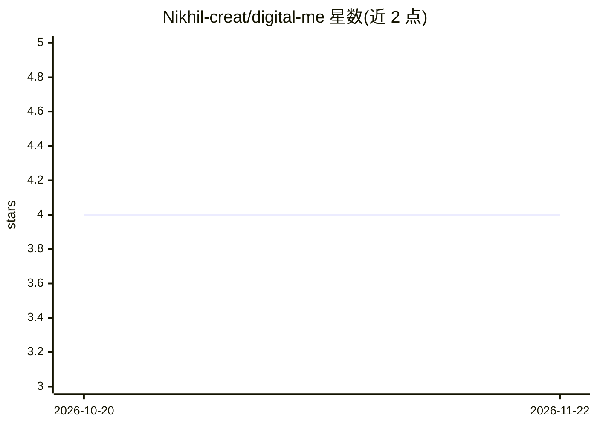

# Nikhil-creat/digital-me

⭐ 4 · Python · 推送 2026-10-10 · [GitHub](https://github.com/Nikhil-creat/digital-me) · [官网](https://nikhil-creat.github.io/digital-me/) · 个人维护

**个人 AI 分身：RAG 问答、语音对话与数字人头像**

将个人形象与知识封装为可对话的数字分身：前端为可离线运行的 PWA（GitHub Pages 托管），后端为 FastAPI + ChromaDB（bge-small 嵌入）+ OpenAI 兼容 LLM 的 Docker 部署，带 Caddy HTTPS。功能包括口型同步头像、多语言语音输入输出、角色过滤的 RAG、LangGraph 多智能体（路由/知识/工具/联系代理加事实核查批评循环）、摄像头情绪检测、JWT 角色权限、注入防护与 PII 脱敏。Wav2Lip 与 XTTS 许可为非商业用途。

## 筛选速览

| 维度 | 判定 | 备注 |
|---|---|---|
| AI 角色 | `ai-native` | 本体是模型或模型工具 |
| 许可风险 | `none` | — |
| 部署形态 | `self-host` | docker 或自建部署 |
| 模型依赖 | — | README 未给出锁定关系 |
| 硬件要求 | — | 无带数字的原话,不猜 |
| 安装摩擦 | `low` | 无编译、无系统依赖或容器化 |
| 成熟度 | — | 结构信号不足 |

## 能力要点

- LangGraph 多智能体：路由/知识/工具/联系代理与事实核查批评循环
- RAG 基于角色过滤的向量检索，拥有者可经仪表盘添加知识
- 语音输入输出支持英语/泰卢固语/印地语，可接 XTTS/Piper 克隆语音或 edge-tts
- 防护机制：注入模式拦截、PII 脱敏、限流、JWT 角色、审计日志

## 适用场景

- 搭建自己的数字分身回答访客提问
- 个人主页集成语音与头像交互
- 留言收集与拥有者后台知识管理

## 场景标签

`RAG` `文档问答` `语音合成` `多智能体` · 领域:Agent 开发

## 证据(README 行号)

> L6: - `backend/` — FastAPI, ChromaDB + fastembed (bge-small), OpenAI-compatible LLM with tool calling, JWT + roles, SSE 
> L9: Photo avatar with audio-driven lip sync · EN/తెలుగు/हिन्दी voice in and out · RAG with role-filtered vector search ·
> L34: LangGraph multi-agent graph (router, knowledge, tool and contact agents, fact-check critic loop) · webcam emotion C

## 星数曲线

2026-10-20 4 → 2026-11-22 4（+0）

---
*卡片 v1 · prompt 1.4 · 生成 2026-11-21 · 置信度 mid · 依据 README sha `63e80151cbcc` · [字段定义](../../DATASET.md)*
