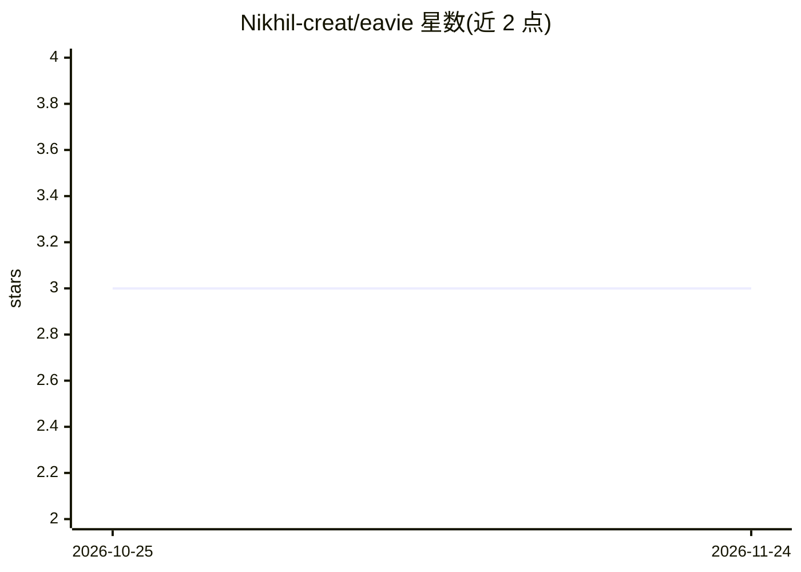

# Nikhil-creat/eavie

⭐ 3 · HTML · MIT · 推送 2026-10-18 · [GitHub](https://github.com/Nikhil-creat/eavie) · [官网](https://nikhil-creat.github.io/eavie/) · 个人维护

**企业级 agentic 视觉智能引擎：LangGraph 代理+混合 RAG**

EAVIE 是一个企业级 agentic 视觉智能引擎，后端基于 FastAPI 异步网关、LangGraph 代理、混合 RAG（BM25 + 稠密检索 + RRF + 重排序）、PyTorch CNN 视觉模块，并使用 Celery、Redis、Postgres 与 Prometheus 组成任务与监控栈，通过 docker compose 一键启动。配套站点经 GitHub Actions 部署至 GitHub Pages。聊天助手功能需用户自行粘贴 Groq API key，该 key 仅存于浏览器本地。项目由个人开发者设计开发，MIT 许可。

## 筛选速览

| 维度 | 判定 | 备注 |
|---|---|---|
| AI 角色 | `ai-native` | 本体是模型或模型工具 |
| 许可风险 | `permissive` | MIT |
| 部署形态 | `self-host` | docker 或自建部署 |
| 模型依赖 | locked-api |  |
| 硬件要求 | — | 无带数字的原话,不猜 |
| 安装摩擦 | `low` | 无编译、无系统依赖或容器化 |
| 成熟度 | — | 结构信号不足 |

## 能力要点

- LangGraph 代理与混合 RAG（BM25+稠密+RRF+重排序）
- PyTorch CNN 视觉模块与 FastAPI 异步网关
- Celery/Redis/Postgres/Prometheus 组成任务与监控栈
- docker compose 一键构建启动

## 适用场景

- 企业内部部署带视觉理解的 agentic 问答系统
- 以混合检索提升知识库问答的召回质量
- 需要任务队列与监控栈配套的 LLM 应用部署

## 场景标签

`Agent 框架` `RAG` `文档问答` · 领域:Agent 开发

## 证据(README 行号)

> L1: # EAVIE — Enterprise Agentic Vision Intelligence Engine
> L5: - Backend: FastAPI, LangGraph, hybrid RAG, PyTorch CNN, Celery, Redis, Postgres, Prometheus (`docker compose up --bu

## 星数曲线

2026-10-25 3 → 2026-11-24 3（+0）

---
*卡片 v1 · prompt 1.4 · 生成 2026-11-22 · 置信度 mid · 依据 README sha `c68647c36902` · [字段定义](../../DATASET.md)*
