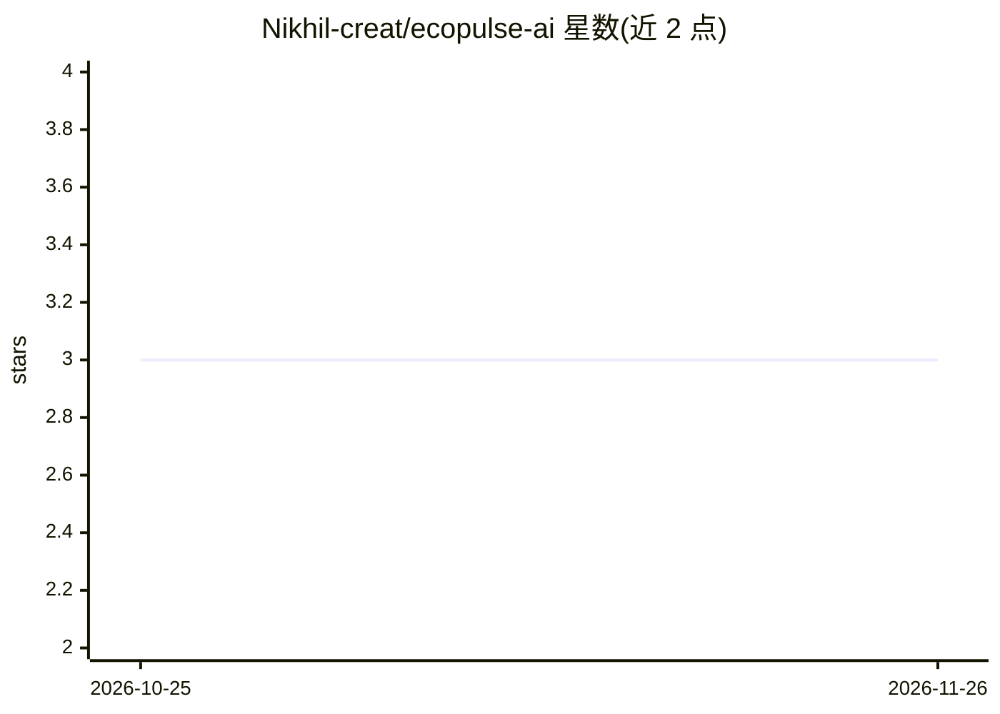

# Nikhil-creat/ecopulse-ai

⭐ 3 · Python · 推送 2026-11-16 · [GitHub](https://github.com/Nikhil-creat/ecopulse-ai) · [官网](https://nikhil-creat.github.io/ecopulse-ai/) · 个人维护

**城市空气质量预测与健康决策平台，含 CNN 与 RAG 机器人**

全栈城市气候平台：接入空气质量数据，用 Holt-Winters 等统计模型输出 6-72 小时多污染物预测并按 24h 留出集择优、每 3 小时重训；PyTorch CNN 分析卫星影像生成烟雾严重度指数；LangGraph 三 Agent 流水线生成健康风险与政策建议（无 LLM 时确定性运行）；pgvector+全文检索的混合 RAG 聊天机器人结合 WHO/CPCB 指南与实时传感数据。Next.js 仪表盘、Prometheus/Grafana 可观测、MCP server。无 API key 时使用标注为模拟的数据；仅作决策支持，非医疗建议。

## 筛选速览

| 维度 | 判定 | 备注 |
|---|---|---|
| AI 角色 | `ai-native` | 本体是模型或模型工具 |
| 许可风险 | `none` | — |
| 部署形态 | `self-host` | docker 或自建部署 |
| 模型依赖 | — | README 未给出锁定关系 |
| 硬件要求 | — | 无带数字的原话,不猜 |
| 安装摩擦 | `low` | 无编译、无系统依赖或容器化 |
| 成熟度 | — | 结构信号不足 |

## 能力要点

- PM2.5/PM10/NO₂/AQI/温度 6-72h 预测，KS-test/Wasserstein 漂移监测触发重训
- ResNet 风格 CNN 产出烟雾严重度指数与绿地密度 3D 热力图
- LangGraph 三 Agent 流水线，Groq/Gemini 仅添加叙述文本
- pgvector + 全文检索 RRF 融合的 RAG 聊天，SSE 流式与 MCP server

## 适用场景

- 查看站点未来 24-72 小时的污染物预测与漂移报告
- 通过聊天机器人基于 WHO/CPCB 指南查询健康建议
- 上传卫星影像获取烟雾严重度分析
- 向 MCP 客户端暴露空气质量与风险评估工具

## 场景标签

`RAG` `聊天机器人` `MLOps` · 领域:对话与助手

## 证据(README 行号)

> L3: **Autonomous Urban Climate Intelligence & Decision Engine**: a full-stack platform that ingests air-quality data, fo
> L18: - **Agentic AI (LangGraph)**: Data Integrity Agent → Forecast & Health Risk Agent → Policy & Mitigation Agent. Work
> L19: - **Hybrid RAG chatbot**: pgvector + full-text search fused with reciprocal-rank fusion over WHO / CPCB guidelines,

## 星数曲线

2026-10-25 3 → 2026-11-26 3（+0）

---
*卡片 v1 · prompt 1.4 · 生成 2026-11-22 · 置信度 high · 依据 README sha `36b4988ca96b` · [字段定义](../../DATASET.md)*
