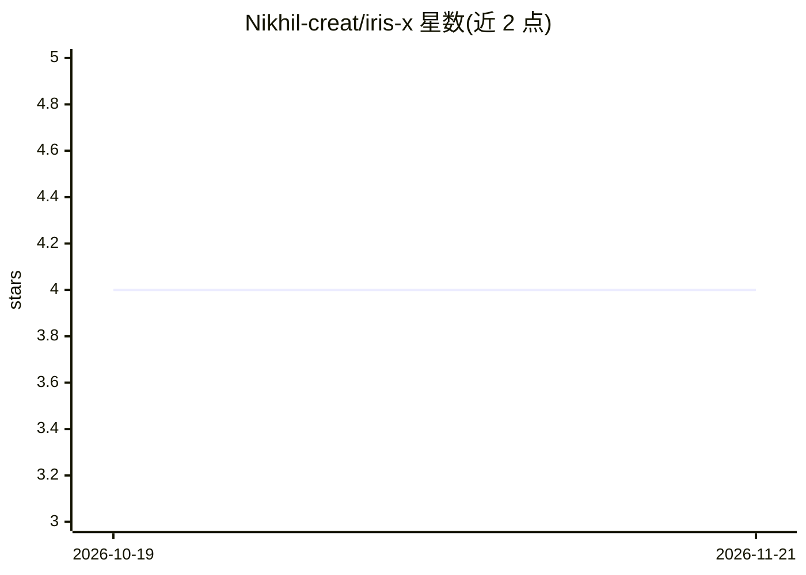

# Nikhil-creat/iris-x

⭐ 4 · TypeScript · MIT · 推送 2026-10-07 · [GitHub](https://github.com/Nikhil-creat/iris-x) · [官网](https://nikhil-creat.github.io/iris-x/) · 个人维护

**基础设施 3D 数字孪生控制台：多 agent 协同巡检与处置**

面向机器人与服务器设施的自研指挥台：WebGL 渲染 3D 数字孪生（机械臂、机架、网关）并实时联动遥测；Robotics/SecOps/Forecaster 三个 agent 并行工作，由 Orchestrator 决策并执行缓解动作；RAG 用 BM25 检索运维手册，CNN 对 12×12 热力图分类四类状态；另带可用工具的个人助手与语音输入输出。浏览器版独立可用，后端为可选的 FastAPI+Redis+Docker 栈；无 AI key 时也能完成流程。

## 筛选速览

| 维度 | 判定 | 备注 |
|---|---|---|
| AI 角色 | `ai-native` | 本体是模型或模型工具 |
| 许可风险 | `permissive` | MIT |
| 部署形态 | `self-host` | docker 或自建部署 |
| 模型依赖 | locked-api |  |
| 硬件要求 | — | 无带数字的原话,不猜 |
| 安装摩擦 | `low` | 无编译、无系统依赖或容器化 |
| 成熟度 | — | 结构信号不足 |

## 能力要点

- 3D 数字孪生实时联动遥测（关节、热度、应力）
- 三 agent 并行的 agentic swarm 与 Orchestrator 决策
- BM25 RAG 检索运维手册为 agent 供地
- Groq/Gemini 双模型自动故障切换与可选共识

## 适用场景

- 演示设施故障时多 agent 的检测与缓解流程
- 巡检服务器机架热状态并导出事件报告
- 通过语音助手查询设施状态、记任务、执行操作

## 场景标签

`多智能体` `RAG` `AI 助手` · 领域:Agent 开发

## 证据(README 行号)

> L19: |**Agentic swarm**|Robotics, SecOps and Forecaster agents work in parallel, grounded by RAG and the CNN. An Orchest
> L21: |**RAG**|BM25 retrieval over operations runbooks grounds every agent, the copilot and the assistant.|
> L28: |**Backend (optional)**|FastAPI + WebSocket, Redis Streams telemetry, agentic state graph, PyTorch CNN, Prometheus 

## 星数曲线

2026-10-19 4 → 2026-11-21 4（+0）

---
*卡片 v1 · prompt 1.4 · 生成 2026-11-21 · 置信度 high · 依据 README sha `ccf26f2896cb` · [字段定义](../../DATASET.md)*
