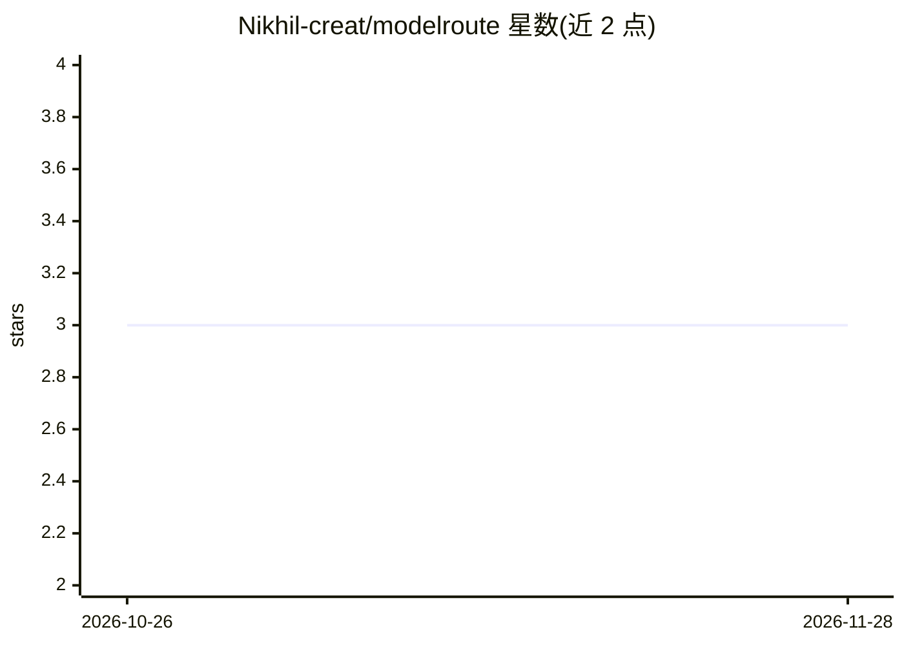

# Nikhil-creat/modelroute

⭐ 3 · Python · NOASSERTION · 推送 2026-10-21 · [GitHub](https://github.com/Nikhil-creat/modelroute) · 个人维护

**按置信度在大/小模型间路由请求的 LLM 路由系统**

一个可运行的 LLM 路由系统：训练分类器预测支持类请求是否需要大模型，简单请求路由到小模型、复杂请求路由到大模型。请求流程包含注入拦截、PII 脱敏、语义缓存、TF-IDF RAG、路由决策、弱答案升级、人工审核队列与 SQLite 日志，并统计成本、延迟与回退率。提供 FastAPI 接口、OpenAPI 文档、MCP server，README 声明内置数据集为合成数据，缓存与限流为单进程内存实现。

## 筛选速览

| 维度 | 判定 | 备注 |
|---|---|---|
| AI 角色 | `ai-ecosystem` | LLM/agent 周边工具 |
| 许可风险 | `none` | NOASSERTION |
| 部署形态 | `library` | 以包/库形式分发 |
| 模型依赖 | — | README 未给出锁定关系 |
| 硬件要求 | — | 无带数字的原话,不猜 |
| 安装摩擦 | `low` | 无编译、无系统依赖或容器化 |
| 成熟度 | — | 结构信号不足 |

## 能力要点

- 分类器预测 p(small is enough) 决定路由到 8B 小模型或 Gemini，含 failover 与熔断
- guard 层做注入拦截与 PII 脱敏，judge 对弱答案升级到大模型
- 每条响应带 trace，/stats 输出成本节省、延迟、回退与缓存率
- 提供 MCP server、可选 PyTorch CNN 截图分类器与 LoRA 微调脚本

## 适用场景

- 为支持工单系统按难度路由到不同规模模型以控制成本
- 在本地 mock 模式无 API key 演示完整路由与日志流程
- 用自己标注的 tickets 数据重新训练路由器并生成评测报告

## 场景标签

`模型网关` `微调` · 领域:Agent 开发

## 证据(README 行号)

> L4: A working LLM routing system. A trained classifier predicts whether a support request needs a large model; easy requ
> L16: `guard` (injection block, PII redaction) → `semantic cache` → `RAG` (TF-IDF over `kb/`) → `router` (p(small is enou

## 星数曲线

2026-10-26 3 → 2026-11-28 3（+0）

---
*卡片 v1 · prompt 1.4 · 生成 2026-11-22 · 置信度 high · 依据 README sha `22a369512950` · [字段定义](../../DATASET.md)*
