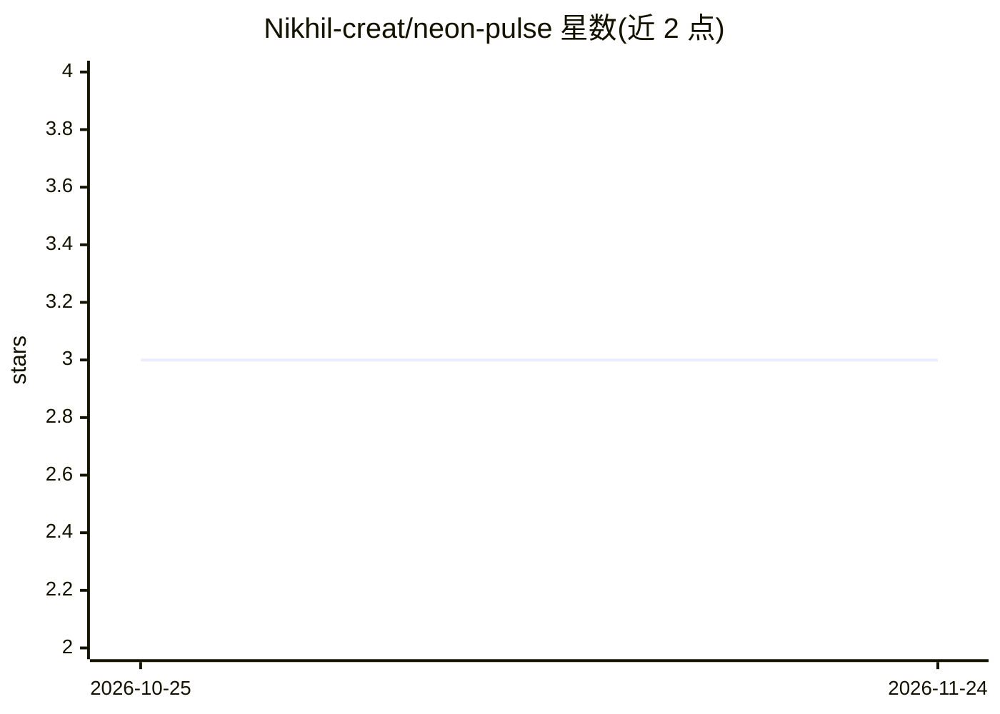

# Nikhil-creat/neon-pulse

⭐ 3 · Python · MIT · 推送 2026-10-22 · [GitHub](https://github.com/Nikhil-creat/neon-pulse) · [官网](https://nikhil-creat.github.io/neon-pulse/) · 个人维护

**AI 点击游戏平台：内置智能体、RAG 聊天与手势控制**

一个点击类网页游戏平台，游戏本体可在无后端情况下运行（本地档案、排行榜、五种模式、P2P 对战）；可选 Docker 全栈后端增加 LangGraph 智能体（导演、反作弊、画像、解说）、混合 RAG、HMAC 签名分数、JWT 认证与 Prometheus 监控。AI 部分包括基于 Groq/Gemini function calling 的 Click-Bot 与 AI 教练、PyTorch 手势 CNN + OpenCV 摄像头动作模式、SD-Turbo 扩散头像服务。静态站部署于 GitHub Pages，也可选 Next.js 前端。作者声明部分组件未在本仓库执行验证。

## 筛选速览

| 维度 | 判定 | 备注 |
|---|---|---|
| AI 角色 | `ai-enhanced` | 去掉 AI 部分产品仍成立 |
| 许可风险 | `permissive` | MIT |
| 部署形态 | `self-host` | docker 或自建部署 |
| 模型依赖 | locked-api |  |
| 硬件要求 | — | 无带数字的原话,不猜 |
| 安装摩擦 | `low` | 无编译、无系统依赖或容器化 |
| 成熟度 | `idea` | |

## 能力要点

- LangGraph 多智能体（director/anti-cheat/profiler/commentator）与混合 RAG（BM25+BGE+RRF+HyDE+cross-encoder）
- PyTorch 手势 CNN，提供 Colab 训练流程与数据采集页
- 浏览器内 Click-Bot 支持 Groq function calling / Gemini，可选 WebGPU 设备端模型
- HMAC 签名分数与 Redis 实时排行榜

## 适用场景

- 玩一个带 AI 教练和语音控制的点击游戏
- 用自己的摄像头手势作为游戏输入方式
- 学习 FastAPI + LangGraph + RAG 的游戏化示例部署

## 场景标签

`聊天机器人` `RAG` `目标检测` · 领域:对话与助手

## 证据(README 行号)

> L14: - **Works with no backend:** local profiles, boards, friends, rewards, achievements, five game modes, power-up ring
> L15: - **AI in the browser:** Click-Bot agent with Groq function calling or Gemini (your free key), optional **on-device
> L16: - **Full backend (Docker):** FastAPI + Postgres + Redis (or Redis Cluster) + Qdrant; LangGraph agents (director, an

## 星数曲线

2026-10-25 3 → 2026-11-24 3（+0）

---
*卡片 v1 · prompt 1.4 · 生成 2026-11-22 · 置信度 high · 依据 README sha `5cb0d296309d` · [字段定义](../../DATASET.md)*
