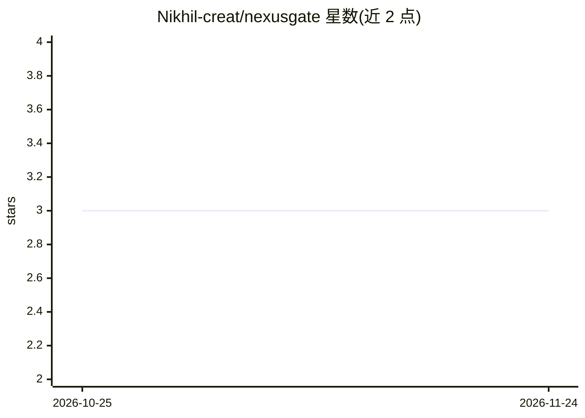

# Nikhil-creat/nexusgate

⭐ 3 · Go · 推送 2026-10-16 · [GitHub](https://github.com/Nikhil-creat/nexusgate) · [官网](https://nikhil-creat.github.io/nexusgate/) · 个人维护

**面向 AI/API 流量的 Go 网关：负载均衡、限流与鉴权**

用 Go 编写的 AI/API 网关，提供代理转发、池化缓冲负载均衡、熔断器、Redis Lua 原子令牌桶限流、RS256 JWT/JWKS 鉴权、内存语义缓存、启发式威胁过滤、A2A 防护与 Prometheus 指标。通过 docker compose 启动，健康检查与指标暴露在本地端口；另含 k6 压测脚本和部署到 GitHub Pages 的展示站点，站点内含一个需用户粘贴 Groq key 的聊天机器人。README 声明 Redis 客户端、RAG 中的 Redis Search/HNSW、cnn_filter 的 ONNX 模型、mTLS、OTel 导出器等尚未接入生产。

## 筛选速览

| 维度 | 判定 | 备注 |
|---|---|---|
| AI 角色 | `ai-ecosystem` | LLM/agent 周边工具 |
| 许可风险 | `none` | — |
| 部署形态 | `self-host` | docker 或自建部署 |
| 模型依赖 | — | README 未给出锁定关系 |
| 硬件要求 | — | 无带数字的原话,不猜 |
| 安装摩擦 | `low` | 无编译、无系统依赖或容器化 |
| 成熟度 | `idea` | |

## 能力要点

- 负载均衡（池化缓冲）、熔断器、本地+Lua 脚本令牌桶限流
- RS256 JWT/JWKS 鉴权与内存语义缓存
- Prometheus 指标与 k6 负载测试脚本
- docker compose 一键启动，GitHub Pages 展示站点含 Groq 聊天机器人

## 适用场景

- 为 LLM 上游流量做负载均衡与限流
- 用 JWKS_URL 做 API 鉴权接入
- 用 Prometheus 与 k6 观测网关性能

## 场景标签

`模型网关` `聊天机器人` · 领域:Agent 开发

## 证据(README 行号)

> L1: # NexusGate: AI & API Gateway (Go 1.22+)
> L5: - `cmd/gateway`, `internal/*`: the Go gateway (proxy, mcp, rag, cnn_filter, ratelimit, breaker, telemetry)
> L24: Implemented (new: RS256 JWT/JWKS auth via JWKS_URL): LB with pooled buffers, breaker, token bucket (local plus Lua 

## 星数曲线

2026-10-25 3 → 2026-11-24 3（+0）

---
*卡片 v1 · prompt 1.4 · 生成 2026-11-22 · 置信度 high · 依据 README sha `e661630ccaec` · [字段定义](../../DATASET.md)*
