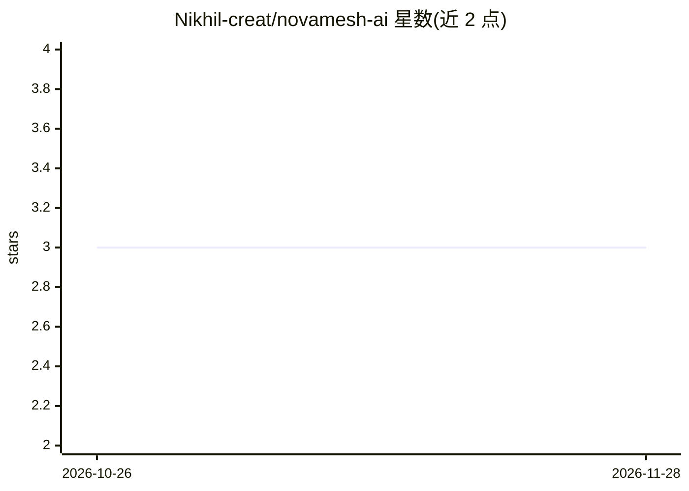

# Nikhil-creat/novamesh-ai

⭐ 3 · Python · MIT · 推送 2026-10-18 · [GitHub](https://github.com/Nikhil-creat/novamesh-ai) · [官网](https://nikhil-creat.github.io/novamesh-ai/) · 个人维护

**自主多智能体 AI 网格平台：安全检测与共识治理**

由 NIKHIL CHARY SRIRAMOJU 设计开发的多智能体系统：由 CNN 视觉安全模块、纠正式 RAG、加权共识机制与人工审批动作组成，以自主 agent mesh 形式运行。后端基于 FastAPI + LangGraph + PyTorch 构建，集成 Groq，提供 Docker Compose 部署方式；仓库另含 GitHub Pages 展示站点文档与部署指南（GUIDE.md、docs/）。可见 README 仅含仓库结构概览，详细说明位于 backend/README.md。

## 筛选速览

| 维度 | 判定 | 备注 |
|---|---|---|
| AI 角色 | `ai-native` | 本体是模型或模型工具 |
| 许可风险 | `permissive` | MIT |
| 部署形态 | `self-host` | docker 或自建部署 |
| 模型依赖 | — | README 未给出锁定关系 |
| 硬件要求 | — | 无带数字的原话,不猜 |
| 安装摩擦 | `low` | 无编译、无系统依赖或容器化 |
| 成熟度 | — | 结构信号不足 |

## 能力要点

- CNN 视觉安全模块与纠正式 RAG
- 加权共识机制与人审批（human-in-the-loop）动作
- FastAPI + LangGraph + PyTorch 后端，Docker Compose 部署

## 适用场景

- 部署带人工审批环节的多智能体工作流
- 为 agent 动作添加共识治理与视觉安全检测

## 场景标签

`Agent 框架` `多智能体` `RAG` · 领域:Agent 开发

## 证据(README 行号)

> L2: Autonomous agent mesh · CNN vision security · corrective RAG · consensus-governed actions.
> L7: - `backend/` — FastAPI + LangGraph + PyTorch platform (Docker Compose, see `backend/README.md`)

## 星数曲线

2026-10-26 3 → 2026-11-28 3（+0）

---
*卡片 v1 · prompt 1.4 · 生成 2026-11-22 · 置信度 mid · 依据 README sha `c8e67cfe6875` · [字段定义](../../DATASET.md)*
