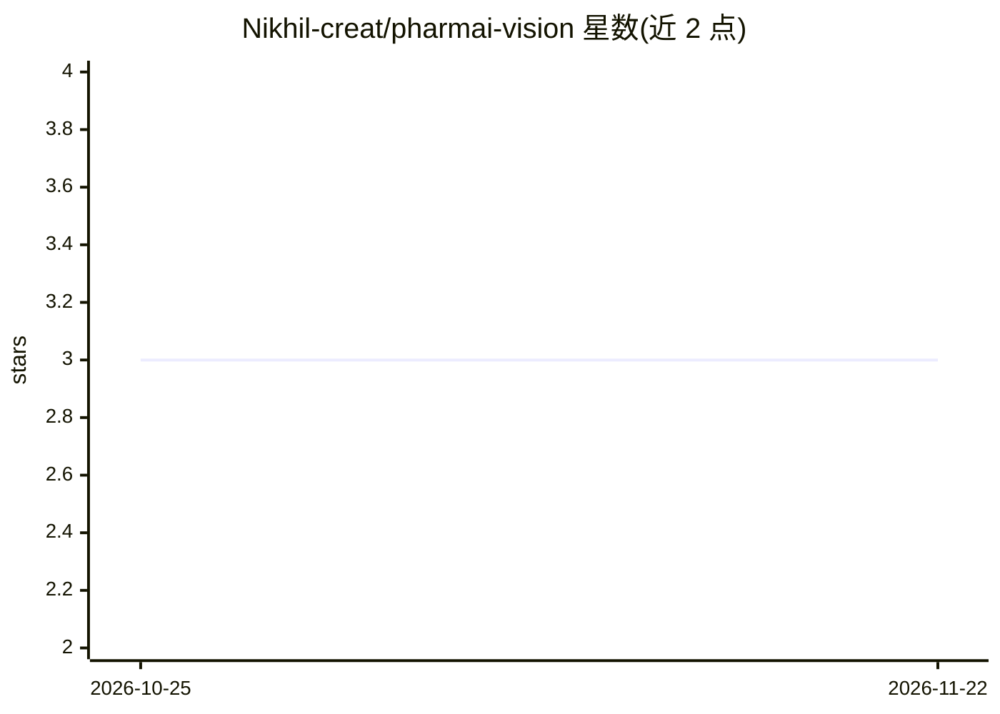

# Nikhil-creat/pharmai-vision

⭐ 3 · Python · MIT · 推送 2026-10-13 · [GitHub](https://github.com/Nikhil-creat/pharmai-vision) · [官网](https://nikhil-creat.github.io/pharmai-vision/) · 个人维护

**视觉 AI 药品识别与健康问答助手**

面向用户的药品助手应用：通过视觉 AI 扫描药盒/药片识别药品，基于 FDA 数据源（RxNorm、DailyMed、openFDA 等）生成带引用的回答，提供药物相互作用检查、带提醒的药箱、英/泰卢固/印地语语音输入。架构为 Next.js PWA 前端加 FastAPI 网关，后端含 LangGraph 多智能体、Neo4j 图检索与 CNN+ViT/OCR 视觉服务，用 docker compose 编排。README 声明仅供教育用途，不可替代药师或医生。

## 筛选速览

| 维度 | 判定 | 备注 |
|---|---|---|
| AI 角色 | `ai-native` | 本体是模型或模型工具 |
| 许可风险 | `permissive` | MIT |
| 部署形态 | `self-host` | docker 或自建部署 |
| 模型依赖 | locked-api |  |
| 硬件要求 | — | 无带数字的原话,不猜 |
| 安装摩擦 | `low` | 无编译、无系统依赖或容器化 |
| 成熟度 | — | 结构信号不足 |

## 能力要点

- 视觉识别药盒/药片（CNN+ViT 模型、OCR、ONNX 导出）
- 基于 openFDA/DailyMed 等数据源的可引用回答
- 药物相互作用检查与带提醒的药箱
- 英/泰卢固/印地语语音输入与 WebSocket 流式响应

## 适用场景

- 拍摄药盒或药片获取药品信息与引用来源
- 检查多种药物间的相互作用
- 管理个人药箱并设置服药提醒
- 用语音以英/泰卢固/印地语进行提问

## 场景标签

`多模态` · 领域:感知与多模态

## 证据(README 行号)

> L11:   U[User: image / text / voice] --> FE[Next.js PWA]
> L27: |`services/agents/`|LangGraph multi-agent graph|

## 星数曲线

2026-10-25 3 → 2026-11-22 3（+0）

---
*卡片 v1 · prompt 1.4 · 生成 2026-11-22 · 置信度 high · 依据 README sha `b4fef3109496` · [字段定义](../../DATASET.md)*
