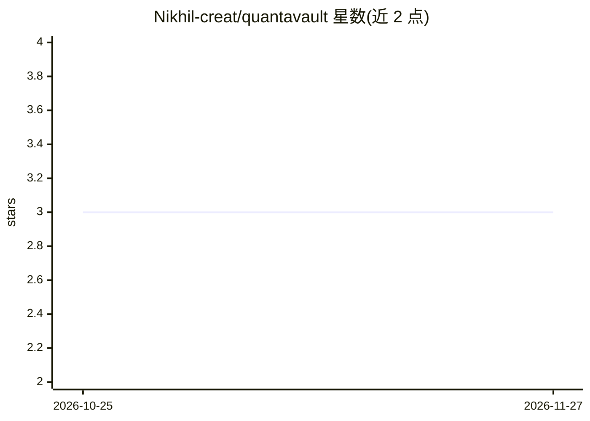

# Nikhil-creat/quantavault

⭐ 3 · HTML · MIT · 推送 2026-10-17 · [GitHub](https://github.com/Nikhil-creat/quantavault) · [官网](https://nikhil-creat.github.io/quantavault/) · 个人维护

**个人零知识加密保险库，内置 Groq 驱动的 AI 助手**

浏览器端加密保险库：文本与文件在客户端用 AES-256-GCM 加密后存储于 IndexedDB，支持 passkey 二次验证、自动锁定、加密备份/恢复、密码短语更换（原子重加密）与哈希链审计日志。AI 部分包括调用 Groq 工具的 VaultMind agent 与 Quanta 个人助手（计算器、计时器、待办、语音输入输出），发送前对敏感数据做掩码处理，RAG 搜索默认关闭。前端可部署为 PWA 至 GitHub Pages，FastAPI 后端经 Docker 运行，CNN 文件检查器自带未训练模型与开箱即用的熵启发式。

## 筛选速览

| 维度 | 判定 | 备注 |
|---|---|---|
| AI 角色 | `ai-enhanced` | 去掉 AI 部分产品仍成立 |
| 许可风险 | `permissive` | MIT |
| 部署形态 | `self-host` | docker 或自建部署 |
| 模型依赖 | locked-api |  |
| 硬件要求 | — | 无带数字的原话,不猜 |
| 安装摩擦 | `low` | 无编译、无系统依赖或容器化 |
| 成熟度 | — | 结构信号不足 |

## 能力要点

- 客户端 AES-256-GCM 加密，文件名与待办一并加密存储
- Groq 工具调用 agent（VaultMind）与 Quanta 助手，含敏感数据掩码与请求台账
- passkey 二次验证、自动锁定、加密备份/恢复
- 可安装 PWA，支持离线缓存

## 适用场景

- 在浏览器中加密保存个人文件、笔记与待办清单
- 配合 Groq key 使用带隐私掩码的 AI 助手管理保险库
- 部署到 GitHub Pages 作为个人加密工具站

## 场景标签

`AI 助手` `RAG` · 领域:对话与助手

## 证据(README 行号)

> L16: Client-side AES-256-GCM text and file encryption (.qvault), passkey demo, hash-chained audit log, VaultMind agent (
> L31: Sensitive-data masking before any text goes to the AI (cards via Luhn, ID numbers, phones, emails, PAN, passwords, 

## 星数曲线

2026-10-25 3 → 2026-11-27 3（+0）

---
*卡片 v1 · prompt 1.4 · 生成 2026-11-22 · 置信度 high · 依据 README sha `60eae2aef6e3` · [字段定义](../../DATASET.md)*
