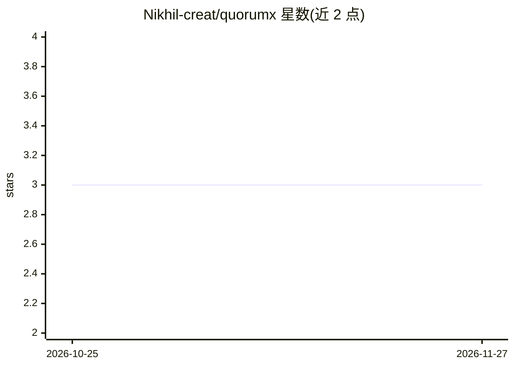

# Nikhil-creat/quorumx

⭐ 3 · HTML · 推送 2026-10-15 · [GitHub](https://github.com/Nikhil-creat/quorumx) · [官网](https://nikhil-creat.github.io/quorumx/) · 个人维护

**浏览器端 Raft KV 集群演示页，含 Groq 助手与 CNN 热力图**

一个以 index.html 为主的 GitHub Pages 单页演示项目：提供 Raft 模拟、Groq 驱动的 AI 助手、CNN 异常热力图、agent、chaos suite、RBAC 多租户与 Merkle 审计视图；仓库另含 docker-compose.yml、Dockerfile、prometheus/ 与 proto/ 等真实 Go 后端的部署脚手架（标注为下一阶段）。部署方式为推送仓库后经 GitHub Actions 自动发布到 Pages，助手需用户自取 Groq key 并仅存于浏览器。作者署名 NIKHIL CHARY SRIRAMOJU。

## 筛选速览

| 维度 | 判定 | 备注 |
|---|---|---|
| AI 角色 | `ai-native` | 本体是模型或模型工具 |
| 许可风险 | `none` | — |
| 部署形态 | `self-host` | docker 或自建部署 |
| 模型依赖 | locked-api |  |
| 硬件要求 | — | 无带数字的原话,不猜 |
| 安装摩擦 | `low` | 无编译、无系统依赖或容器化 |
| 成熟度 | `idea` | |

## 能力要点

- index.html 单页集成 Raft 模拟、Groq 助手、CNN 热力图与 chaos suite
- Groq key 仅存于浏览器本地
- GitHub Actions 自动部署到 GitHub Pages
- 附带 Go 后端的 docker-compose/Dockerfile/prometheus 部署脚手架

## 适用场景

- 在浏览器中演示 Raft 分布式共识行为
- 使用 Groq 助手交互式查询模拟集群状态
- 查看 CNN 异常检测热力图与 Merkle 审计视图

## 场景标签

`AI 助手` · 领域:对话与助手

## 证据(README 行号)

> L4: - `index.html`: live demo (Raft sim, Groq assistant, CNN heatmap, agent, chaos suite, RBAC tenants, Merkle audit)
> L5: - `docker-compose.yml`, `Dockerfile`, `prometheus/`, `proto/`, `docs/`: deployment scaffold for the real Go backend 

## 星数曲线

2026-10-25 3 → 2026-11-27 3（+0）

---
*卡片 v1 · prompt 1.4 · 生成 2026-11-22 · 置信度 low · 依据 README sha `8334a77bcbcc` · [字段定义](../../DATASET.md)*
