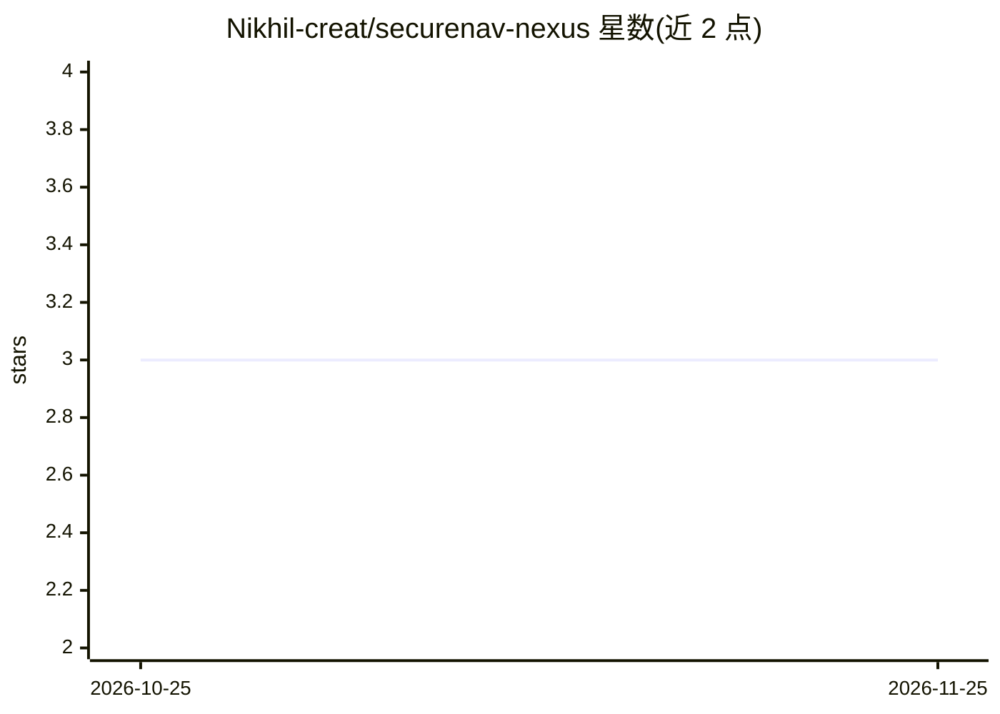

# Nikhil-creat/securenav-nexus

⭐ 3 · Python · MIT · 推送 2026-11-16 · [GitHub](https://github.com/Nikhil-creat/securenav-nexus) · [官网](https://nikhil-creat.github.io/securenav-nexus/) · 个人维护

**为自主机器人提供零信任网络攻击检测与审计防御平台**

面向自主机器人/无人机的零信任防御平台：通过 ROS 2 + SROS2 通信、CNN+ViT 边缘感知、EKF 传感器融合与欺骗门控检测攻击并触发 fail-safe，配合 ML 入侵检测（IsolationForest/自编码器+eBPF）、签名审计账本、任务策略引擎与机群编排。附带 Groq 驱动的 AI copilot 与 FastAPI 3D 数字孪生控制台。核心纯逻辑模块经单元测试，ROS 2 节点、TensorRT、eBPF、GPU 路径及 Docker/K8s 部署需真实环境验证，HSM 为模拟器，默认视觉权重未训练。

## 筛选速览

| 维度 | 判定 | 备注 |
|---|---|---|
| AI 角色 | `ai-native` | 本体是模型或模型工具 |
| 许可风险 | `permissive` | MIT |
| 部署形态 | `library` | 以包/库形式分发 |
| 模型依赖 | — | README 未给出锁定关系 |
| 硬件要求 | — | 无带数字的原话,不猜 |
| 安装摩擦 | `low` | 无编译、无系统依赖或容器化 |
| 成熟度 | `idea` | |

## 能力要点

- EKF 传感器融合与卡方检验欺骗门控，拒绝 GPS/相机欺骗
- hash chain + Ed25519 + Merkle root 的篡改可检测审计账本
- 模型供应链签名校验，视觉节点拒绝被篡改权重
- Hungarian 分配与签名撤销 CRDT 的机群编排与全网隔离

## 适用场景

- 检测并阻断针对自主机器人传感器的欺骗与 DoS 攻击
- 生成防篡改的安全事件审计证据链
- 多机器人机群的任务分配与被入侵节点隔离
- 在 3D 数字孪生控制台中通过 AI copilot 辅助运维

## 场景标签

`网络安全` · 领域:学习与行业

## 证据(README 行号)

> L7: A zero-trust platform that lets an autonomous robot or drone **detect cyber-physical attacks, fail safe, prove what 
> L35: sensors -> vision (CNN+ViT) --------------------> brain (LangGraph + Qdrant RAG) --policy gate--> /mission/waypoint
> L37: telemetry -> IDS (IsoForest + AE + rules + eBPF) -> /sys/e_stop -> HSM revoke -> fleet CRDT gossip

## 星数曲线

2026-10-25 3 → 2026-11-25 3（+0）

---
*卡片 v1 · prompt 1.4 · 生成 2026-11-22 · 置信度 high · 依据 README sha `e0be077a49ba` · [字段定义](../../DATASET.md)*
