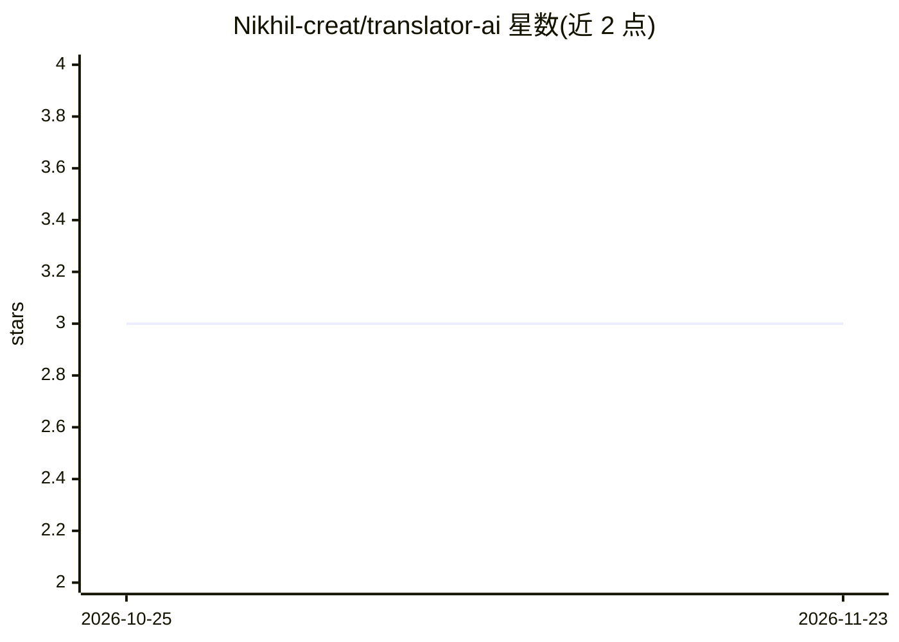

# Nikhil-creat/translator-ai

⭐ 3 · HTML · MIT · 推送 2026-10-15 · [GitHub](https://github.com/Nikhil-creat/translator-ai) · [官网](https://nikhil-creat.github.io/translator-ai/) · 个人维护

**面向翻译用户的多供应商 AI 翻译平台（PWA 静态部署）**

纯静态的多供应商 AI 翻译平台，部署于 GitHub Pages。自动检测用户提供的 Groq/OpenAI/Anthropic/Gemini/OpenRouter/xAI 密钥并加载模型，支持多密钥保管与自动故障切换。翻译流程分 Fast/Agentic（分析→草稿→ critique→润色）/Deep（含回译校验）三种管线，配备 RAG 翻译记忆（.tmx/.csv/.json 导入导出）、25 语言 OCR、PDF 读取、实时语音口译、MQM 质量审计与 PII 掩码等。提供 Docker 开发环境。

## 筛选速览

| 维度 | 判定 | 备注 |
|---|---|---|
| AI 角色 | `ai-native` | 本体是模型或模型工具 |
| 许可风险 | `permissive` | MIT |
| 部署形态 | `self-host` | docker 或自建部署 |
| 模型依赖 | — | README 未给出锁定关系 |
| 硬件要求 | — | 无带数字的原话,不猜 |
| 安装摩擦 | `low` | 无编译、无系统依赖或容器化 |
| 成熟度 | — | 结构信号不足 |

## 能力要点

- 自动检测多供应商密钥，多密钥保管库与自动故障切换
- Fast/Agentic/Deep 三种翻译管线，Agentic 含分析、批评、润色步骤
- RAG 翻译记忆支持 .tmx/.csv/.json 导入导出
- 25 语言 OCR、实时语音口译、实时字幕、MQM 质量审计

## 适用场景

- 将文本、PDF、字幕文件翻译成多种语言
- 面对面语音口译与实时字幕
- 带翻译记忆与术语表的长期翻译项目管理

## 场景标签

`语音 Agent` `RAG` `OCR` `语音识别` · 领域:对话与助手

## 证据(README 行号)

> L2: Agentic, voice-enabled, multi-provider AI translation platform. 100% static: deploys on GitHub Pages.
> L11: - **Any key works:** Groq, OpenAI, Anthropic, Gemini, OpenRouter, xAI auto-detected; models auto-loaded; multi-key 
> L12: - **Pipelines:** Fast / Agentic (Analyze>Draft>Critique>Refine) / Deep (+back-translation verification)

## 星数曲线

2026-10-25 3 → 2026-11-23 3（+0）

---
*卡片 v1 · prompt 1.4 · 生成 2026-11-22 · 置信度 high · 依据 README sha `cf61e30a8f89` · [字段定义](../../DATASET.md)*
