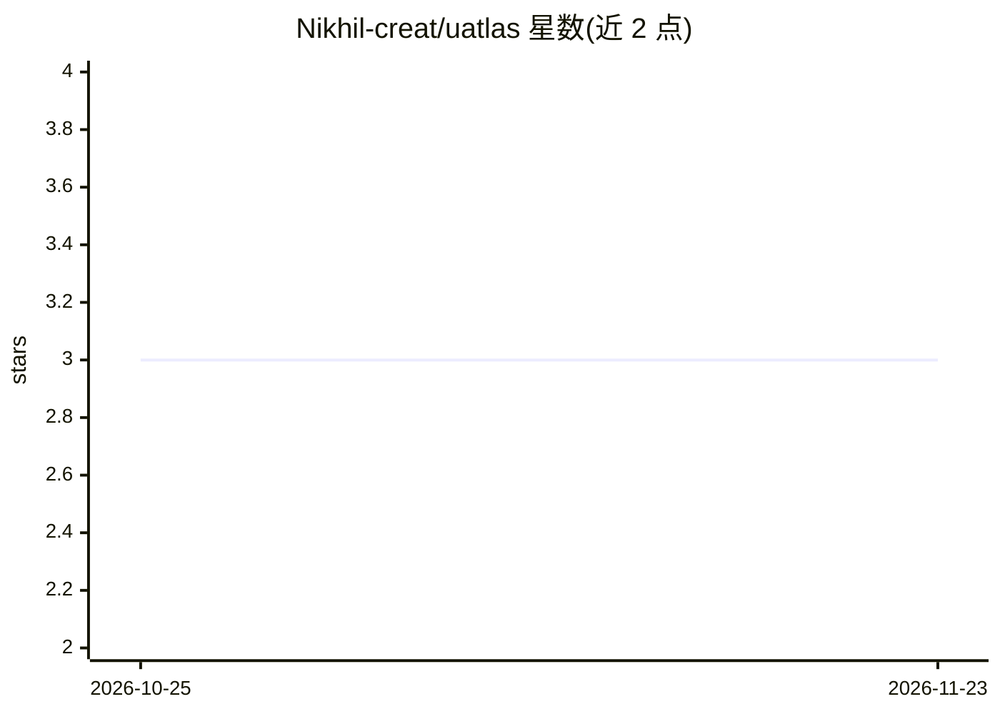

# Nikhil-creat/uatlas

⭐ 3 · HTML · MIT · 推送 2026-10-21 · [GitHub](https://github.com/Nikhil-creat/uatlas) · [官网](https://nikhil-creat.github.io/uatlas/) · 个人维护

**面向开发者的代码库问答 RAG copilot**

Agentic RAG 开发者助手：通过 GitHub API 摄取仓库，按函数/类/标题分块并携带作者、PR、日期元数据，用 Gemini embeddings 与 BM25 做混合检索（倒数排名融合），再经 agent 循环（规划→检索→LLM 重排→反思重搜）生成带引用的回答，LLM 使用 Groq 的 Llama 3.3 70B，Gemini 作后备。以纯前端页面运行，密钥存于浏览器；提供 CLI、Slack bot、Docker compose 与 GitHub Pages 部署。仅支持公开仓库，受 60 次/小时未认证请求与嵌入配额限制。

## 筛选速览

| 维度 | 判定 | 备注 |
|---|---|---|
| AI 角色 | `ai-native` | 本体是模型或模型工具 |
| 许可风险 | `permissive` | MIT |
| 部署形态 | `self-host` | docker 或自建部署 |
| 模型依赖 | locked-api |  |
| 硬件要求 | — | 无带数字的原话,不猜 |
| 安装摩擦 | `low` | 无编译、无系统依赖或容器化 |
| 成熟度 | — | 结构信号不足 |

## 能力要点

- 混合检索：BM25+向量，倒数排名融合
- agent 循环带可见执行轨迹与来源引用链接到 GitHub
- 本地浏览器运行，密钥不出浏览器
- docker compose 部署含 PyTorch CNN 图像分析服务与 Slack bot

## 适用场景

- 对代码库、提交、PR、issue 用自然语言提问
- 新成员快速了解陌生仓库（/onboard /summary 等命令）
- 生成仓库的 changelog 与风险洞察

## 场景标签

`RAG` `AI 助手` · 领域:对话与助手

## 证据(README 行号)

> L2: Agentic RAG developer copilot that understands code, commits, PRs, issues and docs, not just files.
> L5: **Pipeline:** GitHub API ingest → smart chunking (function/class/heading) + metadata (author, PR, date) → Gemini emb

## 星数曲线

2026-10-25 3 → 2026-11-23 3（+0）

---
*卡片 v1 · prompt 1.4 · 生成 2026-11-22 · 置信度 high · 依据 README sha `0b60a531e9b7` · [字段定义](../../DATASET.md)*
